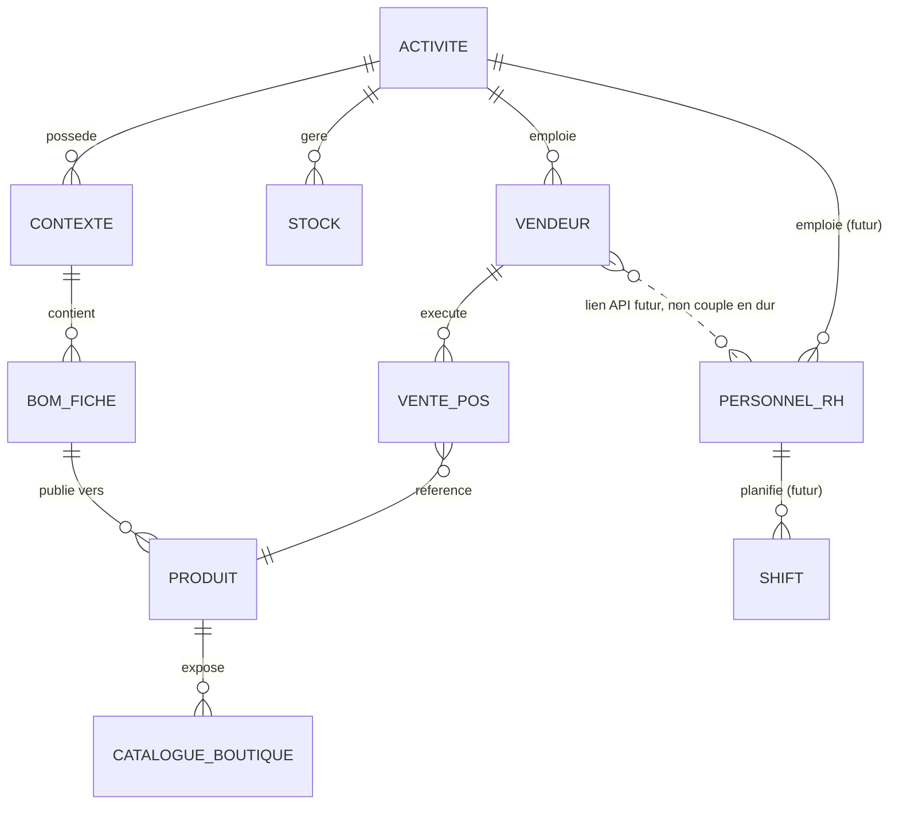
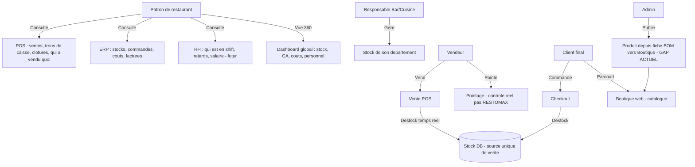

# Fondations du Projet — ArtisaStock (nom temporaire) — Vision Macro HORECA
> mentalyas · Full-Stack Dev
> Date : 2026-07-24
> Statut : Brainstorm macro exporté

> **Lignée du projet** : né comme `charlesnadejda-project` (examen **PDSGBD**, C# WinForms imposé par l'examen — idée d'origine : une app de gestion de stock pour la mère et le beau-père de mentalyas, chocolatiers/pâtissiers). Migré en React/Next.js sous `artisastock-v2` après réussite de l'examen. Ce même projet, en évolution continue, servira ensuite d'examen **PID** puis de **TFE** — un seul projet qui mûrit à travers plusieurs jalons académiques plutôt que d'être recommencé à chaque fois.
>
> Ce document **remplace/généralise** `docs/FONDATION.md` (2026-06-07, cadrage initial "artisans alimentaires") et **absorbe** `docs/FONDATION-POS.md` (2026-07-23, brainstorm POS) suite au pivot de persona décidé dans cette session. `FONDATION-POS.md` reste une référence valide pour le détail des entités POS — à raffiner dans le brainstorm dédié au module POS (voir §9).

---

## 1. Concept Global

ArtisaStock (nom temporaire) est un **logiciel tout-en-un pour restaurateurs** (RH + ERP + POS + Boutique web), centré sur un **patron de restaurant** qui n'est pas nécessairement un expert du métier mais a besoin d'une vue à 360° sur son activité. Les trois modules opérationnels (RH, ERP, POS) et la Boutique web partagent **une seule source de vérité : le stock en base de données**. Le différenciateur central est une **discipline de stock rigide et non contournable** : aucune vente au noir possible, aucun vol d'argent invisible, pertes et négligences ciblées et tracées automatiquement — là où les logiciels HORECA existants (vécus personnellement par mentalyas via 15 ans d'hôtellerie) échouent soit par architecture cassée (POS déconnecté du stock, pointage sans contrôle), soit par fragmentation en outils tiers isolés à la prise en main pénible. Architecture **modulaire, chaque module activable/désactivable indépendamment**, communication strictement via API (jamais de couplage en dur), pour permettre une adoption progressive et une éventuelle extension multi-secteurs plus tard.

---

## 2. Fonctionnalités

### Fonctionnalités core (MVP — déjà construites ou en cours)
- [x] ERP : ingrédients, stock, FIFO réel par lot, fournisseurs, achats (V1 traduit fidèlement, session 2026-07-23)
- [x] BOM multi-niveaux (N1 protégé → N2 → N3), coût de production calculé, production par lots, FIFO incluant les sous-fiches (bug critique corrigé 2026-07-24)
- [x] Multi-tenant (Activité/Stock/Contexte), auth JWT, RBAC de base
- [x] Vitrine cliente (catalogue, checkout) déjà construite côté `storefront/[tenantSlug]/`
- [ ] **Module Boutique/Produits (admin)** — premier chantier du cycle brainstorm-par-module (choisi par mentalyas comme point de départ) : publier un produit fini (issu d'une fiche BOM) vers la vitrine, prix de vente, TVA, stock auto depuis `bom_stocks`. Aujourd'hui `products/page.tsx` et `cms/page.tsx` sont des coquilles vides (12 lignes) alors que la vitrine cliente existe déjà.

### Fonctionnalités secondaires (v2+, brainstorm par module à faire pour chacune)
- [ ] **Module POS** : vente cash/carte déclarative, déstockage temps réel, ouverture/fermeture de caisse (fond + écarts), gestion vendeurs (PIN), disponibilité dynamique par recette, mode hors-ligne tolérant avec sync — doit exposer dès sa conception des points d'API pour une future intégration RH (voir §9)
- [ ] **Module RH** (reporté, mais API prévue dès le POS) : personnel, shifts, fonctions, retards, salaires, pointage horaire fiable et contrôlé (contrairement à RESTOMAX)
- [ ] Rôles Super Admin → Responsable (Bar/Cuisine/autre) → Vendeur, avec propriété de stock par responsable
- [ ] Configuration sectorielle par flags (champs activables selon activité — allergènes/DLC pertinents en alimentaire, pas ailleurs)
- [ ] Intégration terminal de paiement réel (Stripe Terminal, SumUp, Viva Wallet...)

### Hors scope (explicitement exclu pour cette phase)
- Copie de code littéral depuis Dolibarr ou tout autre logiciel GPL — analyse fonctionnelle uniquement (voir §7 Légal)
- Intégration de paiement réel (V1 du POS)
- Impression physique de reçus (V1 du POS)
- Module **FlowGet** (gestionnaire financier en nodes déjà développé par mentalyas) — piste v2+/v3+, pas dans le socle immédiat, existence en tant que projet séparé non confirmée

---

## 3. Structure de Base de Données

Le socle Prisma existant (22 modèles, multi-tenant) reste la base. Les entités POS détaillées dans `docs/FONDATION-POS.md` (Vendeur, SessionCaisse, PointageHoraire, VenteSession, LigneVente, ConfigSectorielle) restent valides comme point de départ mais seront affinées lors du brainstorm dédié au module POS. Le module RH n'a pas encore d'entités définies — à faire lors de son propre brainstorm, en gardant à l'esprit que le POS doit déjà prévoir les points d'API vers lesquels ces futures entités RH se brancheront.

### Diagramme ERD macro (Mermaid)

---

## 4. Diagrammes Use Cases (Mermaid)

---

## 5. Stack Technologique Recommandée

| Couche | Technologie | Justification |
|--------|-------------|----------------|
| Frontend | Next.js 15 App Router | Déjà en place, compatible React (libre pour PID) |
| Backend | Next.js API Routes, `/api/v1/` versionné | Convention déjà posée dans le CLAUDE.md du projet |
| Base de données | PostgreSQL + Prisma | Déjà en place, multi-tenant via `$extends` |
| Auth | JWT existant + PIN rapide vendeur pour le POS | Connexion rapide comptoir sans ressaisir un mot de passe complet |
| Architecture modulaire | Modules activables/désactivables, communication API-first | Décidé cette session — jamais de couplage direct en dur entre modules |
| Hébergement | Vercel + Supabase | Maintenu tel quel pour l'instant ; extensions (PWA offline POS) à revoir lors du brainstorm POS |
| CI/CD | Déploiement Vercel existant | Continuité |

---

## 6. Algorithmes & Patterns Techniques

- **StockService partagé (FIFO)** — une seule fonction de décrément stock FIFO appelée par ERP, Boutique et POS, jamais dupliquée ; inclut désormais le traitement symétrique des lignes `INGREDIENT` et `SHEET` (bug corrigé 2026-07-24).
- **Pattern Fiche/Instance** (hérité de V1, voir `docs/Traduction V1/15-reference-pattern-fiche-instance.md`) — un produit vendu (POS ou Boutique) reste une instance dérivée d'une fiche BOM, jamais un stock créé à la main.
- **Modules activables/désactivables + API-first** — chaque module expose une API stable ; un module en amont (ex. POS) doit prévoir les points d'intégration d'un module en aval pas encore construit (ex. RH), sans attendre son existence.
- **Configuration sectorielle par flags** — table/JSON de fonctionnalités activables par Activité (tenant) plutôt que colonnes obligatoires universelles.
- **Cascade de brainstorms** (méthodologie de travail, codifiée dans `CLAUDE.md`) — macro (ce document) → brainstorm par module produisant use cases + workflow utilisateur complet → implémentation guidée par ce workflow, testée dans le navigateur au fur et à mesure.

---

## 7. Sécurité — Bloc Dédié

### Niveau de sensibilité des données
**Moyen à élevé.** Données financières stratégiques (CA, coûts, marges) dès l'ERP ; le futur module RH ajoutera des données personnelles employés (salaire, pointage horaire = RGPD) ; le POS ajoutera des transactions et écarts de caisse. Aucune donnée de paiement réelle en V1 (labels cash/carte déclaratifs uniquement).

### Vulnérabilités à anticiper
| Risque | Vecteur | Mitigation |
|--------|---------|------------|
| Injection SQL | Requêtes dynamiques mal paramétrées | Prisma (requêtes paramétrées par défaut) |
| Fuite tenant-scoping | Nouvelle entité oubliée du filtrage automatique | Pattern déjà audité une fois (faille ActiviteStock corrigée 2026-07-23) — revalider à chaque nouveau module |
| Usurpation d'identité vendeur (POS) | PIN faible/partagé | PIN suffisamment long, verrouillage après N essais, log par ID vendeur |
| Fuite de données RH | Accès non autorisé aux salaires/pointages | RBAC strict, Vendeur ne voit que ses propres données |
| **Risque légal — licence GPL** | Réutilisation de code littéral depuis Dolibarr (GPL-3.0-or-later) dans un contexte SaaS commercial | Analyse fonctionnelle/schéma uniquement, jamais de copie de code ; réimplémentation indépendante |
| Overselling non détecté (POS offline) | Mode tolérant mal surveillé | Alerte visible dès détection de conflit à la sync, jamais un flag caché |

### Exceptions & Gestion d'erreurs
- Ne jamais exposer les stack traces en production.
- Messages d'erreur génériques pour l'utilisateur final (le vendeur au comptoir ne doit jamais voir une erreur technique brute).
- Logging structuré côté serveur, sans données sensibles (jamais de PIN ou salaire en clair dans les logs).
- Toute vente en conflit (offline) doit rester visible et traçable, jamais silencieusement corrigée.

### Checklist sécurité minimale
- [x] Authentification JWT déjà en place
- [ ] PIN vendeur haché, jamais en clair (module POS)
- [x] HTTPS (Vercel)
- [x] Variables d'env pour les secrets
- [ ] Rate limiting sur les tentatives de PIN (module POS)
- [x] Validation des entrées côté serveur (Zod, déjà en place)
- [ ] RBAC RH vérifié à chaque endpoint (module RH, quand construit)

---

## 8. Références

| Référence | Ce qui est inspirant | Ce qu'on fait différemment |
|-----------|----------------------|------------------------------|
| **RESTOMAX** (vécu par mentalyas comme employé) | — | Repoussoir explicite : config archaïque, POS déconnecté du stock, pointage sans contrôle, reprise de poste "un calvaire" au turnover malgré support technique constant — échec d'architecture, pas de support |
| **Securex** (RH, vécu par mentalyas) | Logiciel bien pensé, complet, utile | Reste un outil tiers isolé, prise en main pénible — on centralise tout dans un seul environnement au lieu d'empiler des silos |
| **Dolibarr** (open source, GPL-3.0-or-later) | Couverture fonctionnelle ERP/CRM/Stock riche, structure de données éprouvée | Licence copyleft forte incompatible avec une réutilisation de code dans un SaaS commercial fermé — analyse fonctionnelle/schéma uniquement, réimplémentation propre |
| Odoo (Manufacturing + POS) | BOM multi-niveaux, POS intégré | Trop complexe/configurable pour une PME — on vise la simplicité tout-en-un préconfiguré |
| Katana MRP | MRP moderne, UI soignée | Pas de POS intégré nativement |
| Cin7 | Gestion stock multi-canal | Cible le retail/e-commerce, pas la production artisanale multi-niveaux ni l'HORECA |

---

## 9. Vers le Cahier des Charges

### Résumé exécutif
Les restaurateurs qui ne sont pas experts du métier logiciel sont mal servis par l'offre HORECA actuelle : soit des architectures cassées où le POS ignore le stock réel et où le turnover de personnel devient un calvaire opérationnel (RESTOMAX), soit des suites complètes mais fragmentées en outils tiers pénibles à intégrer (Securex). ArtisaStock (nom temporaire) propose un logiciel tout-en-un (RH + ERP + POS + Boutique) où le stock fait office de vérité unique et où la discipline de données est imposée par le système, pas laissée à la bonne volonté de l'utilisateur — éliminant structurellement la vente au noir, le vol et les pertes non tracées. Marché cible initial : restaurateurs indépendants (persona ancré dans 15 ans d'expérience terrain de mentalyas), extensible à d'autres PME de production multi-niveaux. Modèle économique envisagé : SaaS multi-tenant. Le projet sert aussi de fil rouge académique (PDSGBD → PID → TFE) et de démonstrateur utilisable par des proches.

### Points ouverts / décisions restantes
- [ ] Exigences exactes de l'examen PID (inconnu à ce jour, React autorisé)
- [ ] Nom définitif du produit (repositionnement de marque au-delà du cadre "artisanal")
- [ ] Granularité exacte des permissions Responsable vs Super Admin
- [ ] Modalités précises de la configuration sectorielle
- [ ] Statut réel du projet FlowGet (externe ? conceptuel ?) avant d'envisager son intégration
- [ ] Stratégie de sortie du mode offline tolérant (POS) vers un mode strict si besoin

### Prochaines étapes
1. ~~**Brainstorm module Boutique/Produits**~~ ✅ fait le 2026-07-24 (`docs/modules/BOUTIQUE-PRODUITS.md`).
2. ~~Implémentation du module Boutique/Produits guidée par ce workflow~~ ✅ terminée le 2026-07-25 (12/12 étapes, `docs/modules/BOUTIQUE-PRODUITS-IMPLEMENTATION.md`).
3. ~~Brainstorm module POS~~ ✅ fait le 2026-07-25 (`docs/modules/POS.md`) — réutilise `ProductChannelStock`/canal `DIRECT` déjà construit, offline et lien RH explicitement différés.
4. **Implémentation du module POS** guidée par ce workflow (en cours — étape 6/7, finalisation vente, terminée le 2026-07-26 ; étape 7 restante : écrans admin de consultation).
5. ~~Brainstorm module Vue Flux (Hub)~~ ✅ fait le 2026-07-26 (`docs/modules/FLUX.md`) — diagramme de flux Stocks liés → Activité → POS/Boutique, permission `flow.read`, volet financier (coûts/valorisation/CA par node) différé en v2 dédié.
6. ~~**Implémentation du module Vue Flux**~~ ✅ terminée le 2026-07-26 (V1 réduite : layout statique sans drag, `docs/modules/FLUX.md`) — POS étape 7 (écrans admin) reste à faire.
7. Brainstorm module RH quand pertinent.
8. Activer l'équipe d'agents IT (PO/Architect/UI-UX) si la complexité d'un module donné le justifie — décision au cas par cas, pas systématique vu le solo + la méthodologie de brainstorm par module déjà en place.
