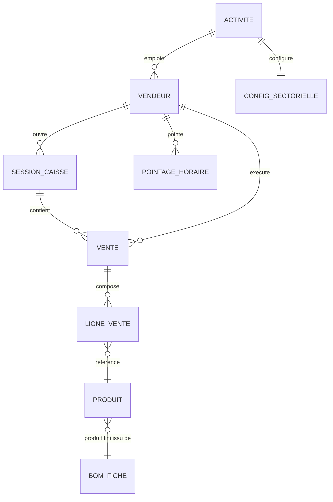
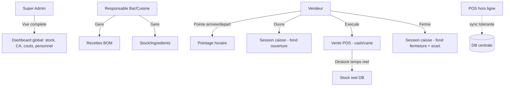

# Fondations du Projet — ArtisaStock (nom temporaire) — Module POS
> mentalyas · Full-Stack Dev
> Date : 2026-07-23
> Statut : Brainstorm initial

---

## 1. Concept Global

Généraliser ArtisaStock — actuellement un ERP pâtisserie artisanale (C# WinForms + Laravel en V1, en cours de portage Next.js en V2) — en un **logiciel tout-en-un (ERP + Boutique Web + POS)** pour PME ayant une production multi-niveaux à partir d'ingrédients/matières premières, tous secteurs confondus (alimentaire, parfumerie, savonnerie, maçonnerie, etc.). Le développement du **POS est priorisé sur la vitrine web actuelle**, qui se limite aujourd'hui à un déstockage passif lors d'un achat client. Les trois modules (ERP, Web, POS) doivent partager une seule source de vérité — le stock en base de données — avec une **discipline de gestion obligatoire** : impossible de vendre (POS ou Web) sans stock correctement encodé. Différenciateur face aux solutions existantes (Odoo, Katana MRP, Cin7) : simplicité et caractère tout-en-un pour petites structures, là où les concurrents ciblent des entreprises plus grandes avec une richesse fonctionnelle qui devient un obstacle pour une PME.

---

## 2. Fonctionnalités

### Fonctionnalités core (MVP)
- [ ] POS configurable : gestion des catégories/produits du point de vente
- [ ] Vente cash/carte en mode déclaratif (label de paiement uniquement, pas d'intégration terminal réel)
- [ ] Déstockage dynamique en temps réel à chaque vente
- [ ] Disponibilité dynamique par recette/produit calculée à partir du stock réel d'ingrédients (réutilise la logique de simulation BOM déjà existante côté V1, appliquée en direct côté vente)
- [ ] Gestion des vendeurs : création, ID unique
- [ ] Ouverture/fermeture de caisse (fond de caisse déclaré en début/fin de service, calcul des écarts)
- [ ] Pointage horaire du vendeur (heures travaillées, lié à son ID)
- [ ] Fonctionnement hors ligne avec synchronisation à la reconnexion — **mode tolérant** : les conflits de stock (overselling) sont détectés et signalés pour résolution manuelle, pas de blocage strict
- [ ] Hiérarchie de rôles : **Super Admin** (vue complète — stock, carte/menu, recettes, ventes, personnel, vendeurs, productions, CA, coûts) → **Responsable** (Bar/Cuisine/autre — gère recettes, stock, encodage ingrédients) → **Vendeur** (exécute la vente, ID tracké par transaction)
- [ ] Configuration sectorielle dès le MVP : champs optionnels/activables selon l'activité (ex. DLC, allergènes — pertinents en alimentaire, pas en maçonnerie)
- [ ] Responsive universel : tablette, dalle tactile, PC, smartphone

### Fonctionnalités secondaires (v2+)
- [ ] Intégration terminal de paiement réel (Stripe Terminal, SumUp, Viva Wallet...)
- [ ] Mode offline strict (réservation de stock par device, élimination complète de l'overselling)
- [ ] Impression de tickets de caisse
- [ ] Repositionnement de marque complet (nouveau nom — le produit dépasse désormais le cadre "artisanal")

### Hors scope (explicitement exclu pour cette phase)
- Intégration de paiement réel (V1 du POS)
- Impression physique de reçus

---

## 3. Structure de Base de Données

Réutilise et étend le socle déjà modélisé côté V1 (voir `docs/Traduction V1/` — notamment `02-etape1-infrastructure.md`, `03-etape2-fiches-stock.md`, `04-etape3-recettes-bom.md` et `15-reference-pattern-fiche-instance.md` pour le pattern Fiche/Instance qui doit rester valable ici : un produit vendu au POS reste une instance dérivée d'une fiche BOM, jamais un stock créé à la main).

### Entités principales (nouvelles, pour le POS)

| Entité | Champs clés | Relations |
|--------|-------------|-----------|
| Vendeur | id, nom, prénom, idUnique/PIN, actif | Appartient à une Activité (tenant) ; lié à SessionCaisse et PointageHoraire |
| SessionCaisse | id, idVendeur, fondCaisseOuverture, fondCaisseFermeture, ecart, dateOuverture, dateFermeture | FK Vendeur |
| PointageHoraire | id, idVendeur, dateHeureArrivee, dateHeureDepart | FK Vendeur |
| VenteSession (ticket POS) | id, idVendeur, idSessionCaisse, modePaiement (cash/carte), total, dateVente, statutSync (synced/pending/conflict) | FK Vendeur, SessionCaisse ; possède des LigneVente |
| LigneVente | id, idVente, idProduit (fiche BOM ou produit catalogue), quantite, prixUnitaire | FK VenteSession |
| ConfigSectorielle | idActivite, champsActifs (flags : DLC, allergènes, etc.) | FK Activité |

### Diagramme ERD (Mermaid)

---

## 4. Diagrammes Use Cases (Mermaid)

---

## 5. Stack Technologique Recommandée

| Couche | Technologie | Justification |
|--------|-------------|----------------|
| Frontend | Next.js 15 App Router (déjà en place côté V2) | Continuité avec l'existant |
| POS offline | PWA + IndexedDB/SQLite WASM + Service Worker | Fonctionnement hors ligne natif navigateur, pas d'app native par device |
| Backend | Next.js API Routes, versionné `/api/v1/` | Cohérent avec la convention déjà posée dans le CLAUDE.md du projet |
| Base de données | PostgreSQL + Prisma (déjà en place côté V2) | Continuité |
| Auth | JWT existant + PIN rapide par Vendeur pour connexion POS comptoir | Connexion rapide sans ressaisir un mot de passe complet à chaque changement de vendeur |
| Sync offline | File d'attente locale rejouée à la reconnexion + détection de conflit serveur | Mode tolérant validé en brainstorm |
| Hébergement | Vercel (déjà en place côté V2) | Continuité |

---

## 6. Algorithmes & Patterns Techniques

- **StockService partagé** — une seule fonction de décrément stock FIFO appelée par ERP, Web et POS, jamais dupliquée à travers les trois modules (cf. algorithme FIFO déjà documenté dans `docs/Traduction V1/12-reference-logique-metier.md`).
- **Réconciliation offline tolérante** — file d'attente locale de ventes horodatées, rejouées séquentiellement à la reconnexion ; toute vente qui ferait passer un stock sous 0 est acceptée mais marquée `conflict=true` pour revue Responsable/Super Admin — pas de rollback automatique.
- **Configuration sectorielle par flags** — table/JSON de fonctionnalités activables par Activité (tenant) plutôt que des colonnes obligatoires universelles.
- **Pattern Fiche/Instance** (déjà établi côté V1, à réutiliser tel quel) — voir `docs/Traduction V1/15-reference-pattern-fiche-instance.md`.

---

## 7. Sécurité — Bloc Dédié

### Niveau de sensibilité des données
**Moyen.** Pas de données de paiement réelles en V1 (labels cash/carte seulement), mais présence de données RH (pointage horaire = donnée personnelle employé, potentiellement sensible RGPD) et de données commerciales stratégiques (CA, coûts, marges).

### Vulnérabilités à anticiper

| Risque | Vecteur | Mitigation |
|--------|---------|------------|
| Injection SQL | Requêtes dynamiques mal paramétrées | Prisma (requêtes paramétrées par défaut) |
| Usurpation d'identité vendeur | PIN faible/partagé | PIN suffisamment long, verrouillage après N essais, log de chaque action par ID vendeur |
| Falsification de vente hors ligne | Manipulation de la queue locale avant sync | Validation des montants côté serveur à la sync (jamais confiance aveugle au payload client) |
| Fuite de données RH (pointage) | Accès non autorisé aux heures travaillées | RBAC strict — Vendeur voit ses propres pointages, Responsable/Super Admin voient l'équipe |
| Overselling non détecté | Mode tolérant mal surveillé | Alerte visible et proactive dès qu'un conflit de stock est détecté à la sync, pas un flag caché en DB |

### Exceptions & Gestion d'erreurs
- Ne jamais exposer les stack traces en production.
- Messages d'erreur génériques pour l'utilisateur final (le vendeur au comptoir ne doit jamais voir une erreur technique brute).
- Logging structuré côté serveur, sans données sensibles (jamais de PIN en clair dans les logs).
- Toute vente en conflit doit rester visible et traçable, jamais silencieusement corrigée.

### Checklist sécurité minimale
- [ ] Authentification sécurisée (PIN haché, jamais en clair)
- [ ] HTTPS obligatoire
- [ ] Variables d'env pour tous les secrets
- [ ] Rate limiting sur les tentatives de PIN
- [ ] Validation des entrées côté serveur (jamais confiance aux montants calculés côté client offline)
- [ ] RBAC vérifié à chaque endpoint API, pas seulement côté UI

---

## 8. Références

| Référence | Ce qui est inspirant | Ce qu'on fait différemment |
|-----------|----------------------|------------------------------|
| Odoo (Manufacturing + POS) | BOM multi-niveaux, POS intégré, généraliste | Trop complexe/configurable pour une PME — on vise la simplicité et le tout-en-un préconfiguré |
| Katana MRP | MRP moderne, UI soignée | Pas de POS intégré nativement |
| Cin7 | Gestion stock multi-canal | Cible plutôt le retail/e-commerce, pas la production artisanale multi-niveaux |

---

## 9. Vers le Cahier des Charges

### Résumé exécutif
Les PME avec une production multi-niveaux (alimentaire, parfumerie, savonnerie, etc.) sont mal servies par les ERP/MRP existants, trop complexes et pensés pour de plus grandes structures. ArtisaStock (nom temporaire) propose un logiciel tout-en-un (ERP + Boutique Web + POS) où le stock fait office de vérité unique et obligatoire, garantissant la fiabilité des données sans discipline manuelle de l'utilisateur. Marché cible : PME multi-secteurs en production artisanale/multi-niveaux. Modèle économique envisagé : SaaS multi-tenant (architecture déjà posée côté V2).

### Points ouverts / décisions restantes
- [ ] Nom définitif du produit (repositionnement de marque)
- [ ] Granularité exacte des permissions Responsable vs Super Admin
- [ ] Modalités précises de la configuration sectorielle (quels champs au-delà de DLC/allergènes)
- [ ] Stratégie de sortie du mode offline tolérant vers un mode strict si les conflits s'avèrent trop fréquents en usage réel

### Prochaines étapes
1. Valider les fonctionnalités core listées ci-dessus.
2. Confirmer la stack (déjà largement héritée de l'existant artisastock-v2).
3. Rédiger le cahier des charges complet (user stories POS détaillées).
4. Activer l'équipe d'agents pour l'implémentation (PO, Architect, UI/UX...) — **côté instance artisastock-v2**, cette instance-ci (charlesnadejda-project) reste sur l'extraction/traduction V1.
