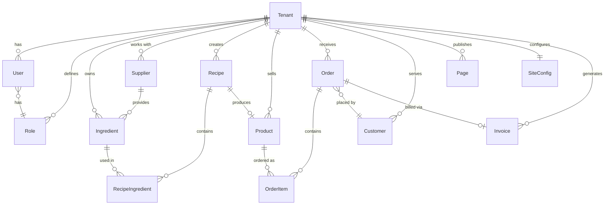
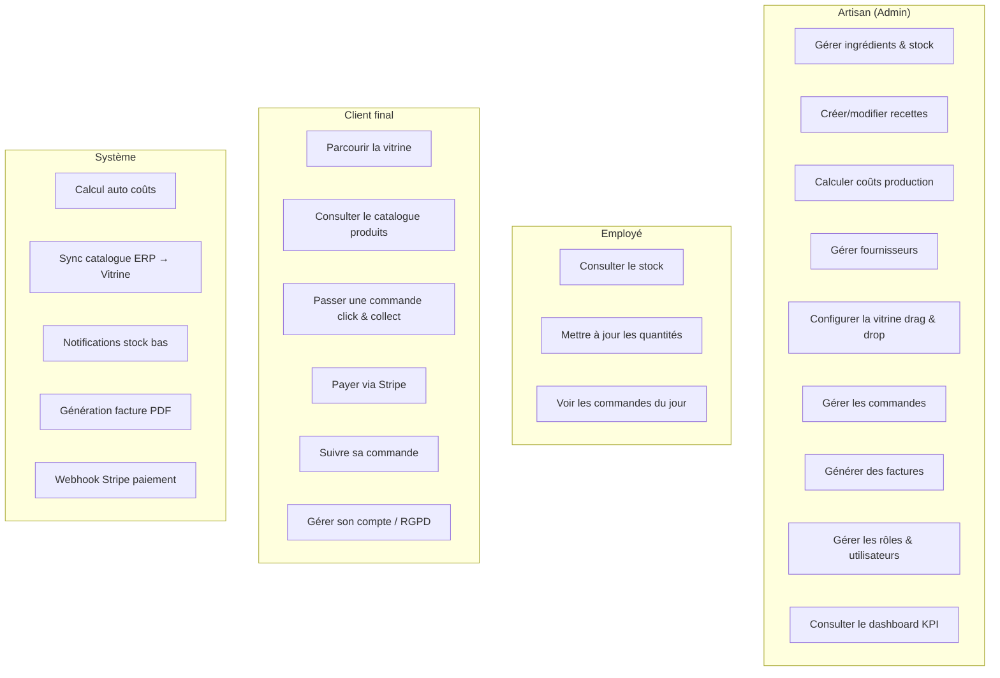

# Fondations du Projet — ArtisaStock V2
> mentalyas · Full-Stack Dev
> Date : 2026-06-07
> Statut : Brainstorm initial

---

## 1. Concept Global

ArtisaStock V2 est un **SaaS tout-en-un** destiné aux artisans de l'alimentation (boulangers, pâtissiers, traiteurs, chocolatiers) qui combine un **ERP de gestion** (stock, recettes, coûts, fournisseurs, facturation) et un **CMS de vitrine e-commerce** (catalogue, commandes click & collect, paiement Stripe).

Le produit cible des **non-techniciens** : interface drag & drop, templates métier prêts à l'emploi, prise en main en quelques minutes. L'artisan gère son activité et sa présence en ligne depuis un seul endroit. Architecture multi-tenant générique adaptable à tout type de commerce alimentaire.

Successeur de CharlesNadejda_Project (ERP WinForms + Laravel académique), reconçu from scratch en full web pour une exploitation commerciale.

---

## 2. Fonctionnalités

### Fonctionnalités core (MVP)

**Module ERP (Backoffice Admin)**
- [ ] Dashboard artisan (KPI : stock bas, commandes du jour, CA)
- [ ] Gestion des ingrédients (stock, prix unitaire/conditionné/lot, seuils d'alerte)
- [ ] Gestion des recettes / fiches techniques (ingrédients, quantités, étapes, coût auto)
- [ ] Calcul automatique des coûts de production (matière première + marge)
- [ ] Gestion des fournisseurs (coordonnées, catalogue, historique commandes)
- [ ] Gestion des produits finis (issus des recettes → mis en vitrine)
- [ ] Facturation conforme TVA belge (génération PDF, numérotation séquentielle)
- [ ] Gestion des commandes clients (réception, statut, historique)
- [ ] RBAC dynamique (rôles custom, permissions par module, multi-niveaux)

**Module CMS (Vitrine)**
- [ ] Templates de vitrine par métier (boulangerie, pâtisserie, traiteur)
- [ ] Personnalisation : logo, couleurs, polices, images
- [ ] Presets de disposition (layouts prédéfinis)
- [ ] Drag & drop pour réarranger les blocs/sections
- [ ] Gestion de pages libres (Accueil, Menu, À propos, Contact, Galerie...)
- [ ] Catalogue produits (synchronisé avec l'ERP)
- [ ] Click & collect : commande + paiement Stripe
- [ ] Page commande avec choix créneau de retrait

**Transversal**
- [ ] Authentification sécurisée (inscription, login, reset password)
- [ ] Multi-langue (FR/NL pour MVP Belgique)
- [ ] RGPD : consentement cookies, droit d'accès/suppression, anonymisation
- [ ] Responsive (mobile-first pour la vitrine, desktop-first pour l'ERP)
- [ ] Onboarding guidé (wizard première config)

### Fonctionnalités secondaires (v2+)

- [ ] Multi-pays (France, Europe — devises, TVA, langues)
- [ ] App mobile (PWA ou React Native)
- [ ] Gestion des livraisons (zones, frais, suivi)
- [ ] Commandes personnalisées (gâteau sur mesure, devis en ligne)
- [ ] Module fidélité client (points, réductions)
- [ ] Statistiques avancées (tendances, prévisions, saisonnalité)
- [ ] Intégration comptable (export vers logiciel compta)
- [ ] Notifications push / email automatisées (commande confirmée, stock bas)
- [ ] Marketplace multi-artisans (place de marché locale)
- [ ] Module planning/production (calendrier, tâches équipe)
- [ ] API publique pour intégrations tierces

### Hors scope (explicitement exclu)

- Application mobile native au MVP
- Livraison à domicile au MVP
- Multi-devise au MVP (EUR uniquement)
- Comptabilité complète (on génère les factures, pas de grand livre)
- Gestion RH / paie
- POS / caisse enregistreuse physique

---

## 3. Structure de Base de Données

### Entités principales

| Entité | Champs clés | Relations |
|--------|-------------|-----------|
| **Tenant** | id, name, slug, plan, settings, locale | hasMany Users, Products, Orders |
| **User** | id, tenantId, email, password, roleId | belongsTo Tenant, Role |
| **Role** | id, tenantId, name, permissions (JSON) | hasMany Users |
| **Ingredient** | id, tenantId, name, unit, priceUnit, pricePack, priceLot, stock, alertThreshold | belongsTo Tenant, hasMany RecipeIngredients |
| **Supplier** | id, tenantId, name, contact, catalog | hasMany Ingredients |
| **Recipe** | id, tenantId, name, steps, yield, costAuto | hasMany RecipeIngredients, hasOne Product |
| **RecipeIngredient** | id, recipeId, ingredientId, quantity | belongsTo Recipe, Ingredient |
| **Product** | id, tenantId, name, price, recipeId, image, visible | belongsTo Recipe, hasMany OrderItems |
| **Order** | id, tenantId, customerId, status, total, pickupSlot, stripePaymentId | hasMany OrderItems, belongsTo Customer |
| **OrderItem** | id, orderId, productId, quantity, unitPrice | belongsTo Order, Product |
| **Customer** | id, tenantId, email, name, phone, address | hasMany Orders |
| **Invoice** | id, tenantId, orderId, number, totalHT, totalTVA, totalTTC, pdfUrl | belongsTo Order |
| **Page** | id, tenantId, slug, title, blocks (JSON), order, visible | belongsTo Tenant |
| **SiteConfig** | id, tenantId, logo, colors, fonts, template, domain | belongsTo Tenant |

### Diagramme ERD (Mermaid)

---

## 4. Diagrammes Use Cases (Mermaid)

---

## 5. Stack Technologique Recommandée

| Couche | Technologie | Justification |
|--------|-------------|---------------|
| **Framework** | Next.js 15 (App Router) | Fullstack, SSR pour vitrine (SEO), API Routes pour backend, écosystème mature |
| **Langage** | TypeScript strict | Type safety, excellente génération par Claude, maintenabilité |
| **ORM** | Prisma | Schema-first, migrations auto, typesafe, multi-tenant friendly |
| **Base de données** | PostgreSQL | Robuste, JSON support, Row Level Security pour multi-tenant |
| **UI** | Tailwind CSS + shadcn/ui | Rapid prototyping, composants accessibles, customisables |
| **Drag & Drop** | dnd-kit | Léger, accessible, React-native compatible |
| **Auth** | NextAuth.js (Auth.js v5) | Session-based, providers multiples, RBAC extensible |
| **Paiement** | Stripe (Checkout + Webhooks) | Standard industrie, conforme PCI-DSS, commission intégrée |
| **Storage fichiers** | Uploadthing ou S3 (via Supabase) | Images produits, logos, PDFs factures |
| **Email** | Resend | Transactionnel (confirmation commande, reset password) |
| **i18n** | next-intl | Multi-langue Next.js natif, FR/NL |
| **PDF** | @react-pdf/renderer | Génération factures conformes |
| **Hébergement** | Vercel (app) + Supabase (DB + Storage) | Tiers gratuits, scaling auto, budget minimal |
| **CI/CD** | GitHub Actions | Gratuit, intégré au repo |
| **Monitoring** | Sentry (gratuit tier) | Error tracking production |

---

## 6. Algorithmes & Patterns Techniques

- **Multi-tenant par schéma partagé** — Un seul schéma DB, chaque requête filtrée par `tenantId`. Simple, économique, suffisant pour PME. Isolation via Prisma middleware.
- **RBAC dynamique** — Table `Role` avec champ `permissions` (JSON array). Middleware vérifie `user.role.permissions.includes(requiredPermission)` à chaque requête.
- **Calcul de coût en cascade** — Quand un prix ingrédient change, recalcul automatique des recettes concernées puis des produits. Pattern Observer / event-driven.
- **Bloc-based CMS** — Pages stockées comme JSON array de blocs typés (`{ type: "hero" | "gallery" | "text" | "products", config: {...} }`). Rendu dynamique côté vitrine.
- **Optimistic UI** — Pour le drag & drop et les actions rapides en backoffice. Mise à jour locale immédiate, sync serveur en background.
- **Webhook-driven payments** — Stripe webhook confirme le paiement → mise à jour statut commande. Jamais se fier au retour client-side.
- **ISR (Incremental Static Regeneration)** — Pages vitrine pré-rendues, revalidées quand l'artisan modifie son contenu. Performance + SEO.

---

## 7. Sécurité — Bloc Dédié

### Niveau de sensibilité des données
**Élevé** — Données personnelles clients (RGPD), données de paiement (Stripe gère PCI-DSS), données commerciales sensibles (prix, marges, fournisseurs).

### Vulnérabilités à anticiper

| Risque | Vecteur | Mitigation |
|--------|---------|------------|
| Injection SQL | Inputs utilisateur | Prisma (requêtes paramétrées), validation Zod |
| XSS | Contenu CMS user-generated | Sanitization DOMPurify, CSP headers stricts |
| CSRF | Formulaires | Tokens CSRF natifs Next.js, SameSite cookies |
| Auth faible | Brute force, password spray | Rate limiting, bcrypt/argon2, 2FA optionnel |
| IDOR | Accès cross-tenant | Middleware tenantId systématique, RLS PostgreSQL |
| File upload malicieux | Images/logos uploadés | Validation MIME type, resize serveur, scan antivirus |
| Stripe webhook forgé | Faux webhooks | Signature verification Stripe obligatoire |
| Data leak cross-tenant | Bug requête sans filtre | Tests automatisés d'isolation tenant |

### Exceptions & Gestion d'erreurs
- Ne jamais exposer les stack traces en production.
- Messages d'erreur génériques pour l'utilisateur final.
- Logging structuré côté serveur (sans données sensibles — jamais de tokens, mots de passe, numéros carte).
- Erreurs Stripe : messages traduits user-friendly, retry automatique webhooks.
- Erreurs de calcul coût : fallback sur dernière valeur connue + alerte admin.

### Checklist sécurité minimale
- [ ] Authentification sécurisée (hash argon2, pas MD5/SHA1)
- [ ] HTTPS obligatoire (forcé par Vercel)
- [ ] Variables d'env pour tous les secrets (Stripe keys, DB URL, etc.)
- [ ] Rate limiting sur login, signup, API publiques
- [ ] Validation des entrées côté serveur (Zod schemas)
- [ ] Headers de sécurité (CSP, HSTS, X-Frame-Options)
- [ ] Isolation multi-tenant vérifiée par tests
- [ ] Audit dépendances (npm audit, Dependabot)
- [ ] Backup DB automatisé (Supabase daily)
- [ ] Logs d'accès admin (qui a fait quoi, quand)

---

## 8. Références

| Référence | Ce qui est inspirant | Ce qu'on fait différemment |
|-----------|---------------------|---------------------------|
| **Wix / Squarespace** | CMS drag & drop, templates, simplicité | Spécialisé métiers de bouche + ERP intégré |
| **Toast POS** | SaaS pour restauration, commandes | Pas de POS physique, focus artisans pas restaurants |
| **Koust** | Gestion coûts/recettes restauration | Plus simple, vitrine intégrée, pas juste back-office |
| **WooCommerce** | E-commerce flexible | Pas de WordPress, tout intégré, plus simple |
| **ArtisaStock V1** | Logique métier ERP (stock, recettes, coûts) | Full web, multi-tenant, générique, CMS intégré |

---

## 9. Vers le Cahier des Charges

### Résumé exécutif (pour business plan)

Les artisans alimentaires (boulangers, pâtissiers, traiteurs) jonglent entre gestion de stock, calcul de prix, et présence en ligne — souvent avec des outils séparés ou du papier. ArtisaStock V2 unifie tout en un SaaS unique : ERP métier + vitrine e-commerce avec builder drag & drop. Cible MVP : artisans belges (FR/NL). Modèle : essai gratuit 1 mois → abonnement mensuel + commission sur ventes en ligne. Différenciateur : simplicité extrême pour non-techniciens, spécialisé alimentaire.

### Points ouverts / décisions restantes

- [ ] Pricing exact de l'abonnement (19€? 29€? 39€/mois ?)
- [ ] Taux de commission sur ventes Stripe (1%? 2%? 3%?)
- [ ] Nom de domaine custom par artisan (sous-domaine gratuit + domaine custom payant ?)
- [ ] Templates : combien au lancement ? (3 minimum ?)
- [ ] Stratégie de migration données V1 → V2 pour Charles & Nadejda
- [ ] Conditions d'utilisation et mentions légales
- [ ] Assurance / responsabilité en cas de bug facturation

### Prochaines étapes

1. ✅ Valider ce document de fondation
2. Définir le pricing et CGV (Conditions Générales de Vente)
3. Activer l'équipe d'agents IT (pipeline Hub & Spoke)
4. Phase 1 : PO → stories, Architecte → archi détaillée, UI/UX → maquettes
5. Phase 2 : Implémentation MVP
6. Phase 3 : Beta test avec artisans locaux
7. Phase 4 : Lancement commercial
