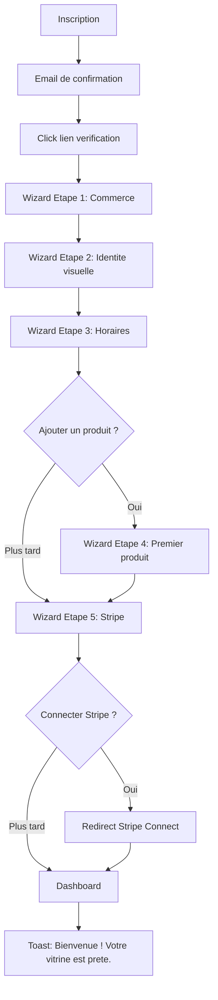
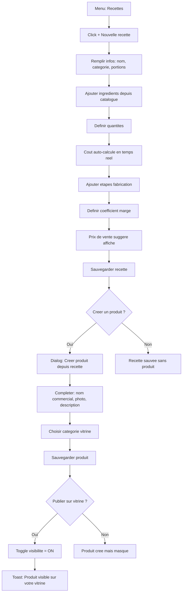
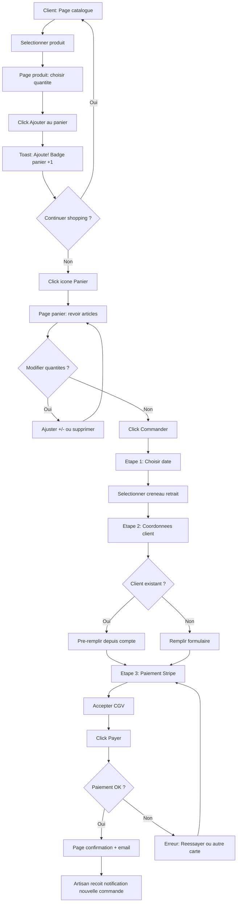
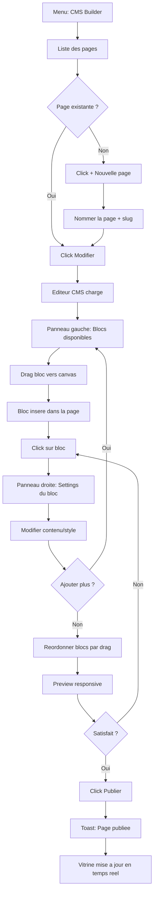

# UI/UX Design System & Wireframes — ArtisaStock V2

> **Auteur :** Agent #3 — UI/UX Designer
> **Date :** 2026-06-07
> **Version :** 1.0.0
> **Stack UI :** Next.js 15 · React · Tailwind CSS · shadcn/ui
> **Cible :** Artisans alimentaires non-techniciens

---

## 1. Design System

### 1.1 Palette de couleurs

Palette optimisee pour le contexte alimentaire/artisanal : chaleur, confiance, lisibilite.
Tous les contrastes respectent WCAG AA (4.5:1 texte normal, 3:1 texte large).

| Role | Token | Hex | Usage |
|------|-------|-----|-------|
| **Primary** | `--color-primary-50` | `#FFF7ED` | Background subtle |
| | `--color-primary-100` | `#FFEDD5` | Background hover |
| | `--color-primary-500` | `#F97316` | Accent, liens |
| | `--color-primary-600` | `#EA580C` | CTA buttons (contrast 4.6:1 sur blanc) |
| | `--color-primary-700` | `#C2410C` | CTA hover |
| | `--color-primary-900` | `#7C2D12` | Texte sur fond clair |
| **Secondary** | `--color-secondary-50` | `#F0FDF4` | Background subtle |
| | `--color-secondary-500` | `#22C55E` | Success accent |
| | `--color-secondary-600` | `#16A34A` | Success buttons |
| | `--color-secondary-700` | `#15803D` | Success hover |
| **Neutral** | `--color-neutral-0` | `#FFFFFF` | Background page |
| | `--color-neutral-50` | `#F9FAFB` | Background card |
| | `--color-neutral-100` | `#F3F4F6` | Background secondaire |
| | `--color-neutral-200` | `#E5E7EB` | Borders |
| | `--color-neutral-300` | `#D1D5DB` | Borders hover |
| | `--color-neutral-400` | `#9CA3AF` | Placeholder text |
| | `--color-neutral-500` | `#6B7280` | Texte secondaire |
| | `--color-neutral-700` | `#374151` | Texte body |
| | `--color-neutral-900` | `#111827` | Texte headings |
| **Success** | `--color-success` | `#16A34A` | Confirmations (contrast 4.5:1) |
| **Warning** | `--color-warning` | `#D97706` | Alertes stock (contrast 4.5:1) |
| **Error** | `--color-error` | `#DC2626` | Erreurs validation (contrast 4.7:1) |
| **Info** | `--color-info` | `#2563EB` | Informations (contrast 4.6:1) |

#### Dark mode (tokens CSS custom)

| Token | Light | Dark |
|-------|-------|------|
| `--bg-page` | `#FFFFFF` | `#0F172A` |
| `--bg-card` | `#F9FAFB` | `#1E293B` |
| `--bg-elevated` | `#FFFFFF` | `#334155` |
| `--text-primary` | `#111827` | `#F1F5F9` |
| `--text-secondary` | `#6B7280` | `#94A3B8` |
| `--border` | `#E5E7EB` | `#334155` |

### 1.2 Typographie

| Element | Font | Size | Weight | Line-height |
|---------|------|------|--------|-------------|
| H1 | Inter | 32px (2rem) | 700 | 1.2 |
| H2 | Inter | 24px (1.5rem) | 600 | 1.3 |
| H3 | Inter | 20px (1.25rem) | 600 | 1.4 |
| H4 | Inter | 16px (1rem) | 600 | 1.5 |
| Body | Inter | 14px (0.875rem) | 400 | 1.5 |
| Body small | Inter | 12px (0.75rem) | 400 | 1.5 |
| Label | Inter | 14px (0.875rem) | 500 | 1.4 |
| Button | Inter | 14px (0.875rem) | 500 | 1 |
| Caption | Inter | 12px (0.75rem) | 400 | 1.4 |
| KPI value | Inter | 28px (1.75rem) | 700 | 1.2 |

### 1.3 Spacing scale (grille 8px)

| Token | Value | Usage |
|-------|-------|-------|
| `--space-1` | 4px | Micro-gaps (icon-text) |
| `--space-2` | 8px | Entre champs lies |
| `--space-3` | 12px | Padding interne compact |
| `--space-4` | 16px | Padding standard, gap grille |
| `--space-5` | 20px | Separation sections internes |
| `--space-6` | 24px | Padding cards |
| `--space-8` | 32px | Separation sections majeures |
| `--space-10` | 40px | Espacement page vertical |
| `--space-12` | 48px | Header height |
| `--space-16` | 64px | Sidebar collapsed width |

### 1.4 Border radius

| Token | Value | Usage |
|-------|-------|-------|
| `--radius-sm` | 4px | Tags, badges |
| `--radius-md` | 8px | Inputs, buttons, cards |
| `--radius-lg` | 12px | Modals, sheets |
| `--radius-xl` | 16px | Cards promo vitrine |
| `--radius-full` | 9999px | Avatars, pills |

### 1.5 Shadows

| Token | Value | Usage |
|-------|-------|-------|
| `--shadow-sm` | `0 1px 2px rgba(0,0,0,0.05)` | Cards au repos |
| `--shadow-md` | `0 4px 6px rgba(0,0,0,0.07)` | Cards hover, dropdowns |
| `--shadow-lg` | `0 10px 15px rgba(0,0,0,0.1)` | Modals, popovers |
| `--shadow-xl` | `0 20px 25px rgba(0,0,0,0.15)` | Sheets, overlays |

### 1.6 Etats interactifs

| Etat | Transformation | Timing |
|------|---------------|--------|
| **Hover** | Background shift +1 shade, shadow-md | 150ms ease |
| **Focus** | Ring 2px primary-500, offset 2px | instantane |
| **Active** | Scale 0.98, background +2 shades | 100ms |
| **Disabled** | Opacity 0.5, cursor not-allowed, no hover | - |
| **Loading** | Spinner inline + texte "Chargement..." | - |
| **Skeleton** | Pulse animation neutral-200 | 1.5s infinite |

### 1.7 Breakpoints

| Token | Value | Cible |
|-------|-------|-------|
| `sm` | 640px | Mobile landscape |
| `md` | 768px | Tablette portrait |
| `lg` | 1024px | Tablette paysage / petit desktop |
| `xl` | 1280px | Desktop |
| `2xl` | 1440px | Desktop large (design ref) |

**Strategie :**
- ERP (backoffice) : desktop-first, min-width 1024px full, responsive jusqu'a 768px (tablette)
- Vitrine (storefront) : mobile-first, base 375px, scale up

---

## 2. Composants communs (shadcn/ui base)

### 2.1 Navigation

#### Sidebar ERP (`AppSidebar`)

```
Composant : shadcn Sheet (mobile) + fixed aside (desktop)
Largeur : 256px expanded / 64px collapsed
Position : gauche fixe
Contenu :
  - Logo tenant (haut)
  - Navigation links (icons + labels) groupes par section :
    Section "Gestion" : Dashboard, Ingredients, Recettes, Fournisseurs, Produits
    Section "Ventes" : Commandes, Facturation
    Section "Vitrine" : CMS Builder
    Section "Admin" : Utilisateurs, Parametres
  - User avatar + menu (bas)
Behavior :
  - Collapsed sur ecrans < 1280px (icones seules, tooltip au hover)
  - Drawer overlay sur ecrans < 1024px (hamburger menu)
  - Active state : background primary-100, border-left 3px primary-600
  - Badge compteur sur "Commandes" (commandes en attente)
```

#### Header Vitrine (`StorefrontHeader`)

```
Composant : header sticky top-0
Hauteur : 64px (desktop) / 56px (mobile)
Contenu :
  - Logo artisan (gauche)
  - Navigation links : Accueil, Catalogue, [pages CMS], Contact
  - Panier icon + badge count (droite)
  - Hamburger menu (mobile < 768px)
Behavior :
  - Sticky avec backdrop-blur au scroll
  - Menu mobile : sheet slide from right
```

### 2.2 DataTable (`DataTable`)

```
Base : shadcn Table + @tanstack/react-table
Features :
  - Header sticky
  - Tri par colonne (click header → asc → desc → none)
  - Recherche globale (debounce 300ms)
  - Filtres par colonne (dropdown / date range / multi-select)
  - Pagination (10/25/50 par page)
  - Selection multi-lignes (checkbox)
  - Actions bulk (supprimer, exporter)
  - Actions par ligne (menu dots : voir, editer, dupliquer, supprimer)
  - Etats : empty state (illustration + CTA), loading (skeleton rows), error (retry)
  - Responsive : colonnes prioritaires, colonnes secondaires hidden < lg
Layout :
  [Toolbar : Recherche | Filtres | CTA "Ajouter"]
  [Table headers]
  [Table body - rows]
  [Footer : info count | pagination]
```

### 2.3 Forms

#### Pattern Input standard

```
Structure : Label → Input → Helper/Error
Label : 14px medium, mb-1 (4px)
Input : h-40px, px-12px, border neutral-200, radius-md, focus ring primary
Helper : 12px neutral-500, mt-1
Error : 12px error, mt-1, icon alert-circle inline
Required : asterisque rouge apres le label
```

#### Patterns de formulaire

| Pattern | Usage | Composants |
|---------|-------|-----------|
| **Form inline** | Edition rapide dans table | Input sans label, validation au blur |
| **Form card** | Creation/edition complete | Card avec sections, actions footer sticky |
| **Form wizard** | Onboarding, processus multi-etapes | Steps indicator + prev/next buttons |
| **Form sheet** | Ajout rapide sans quitter la page | Sheet slide-in depuis la droite, 480px |
| **Form modal** | Confirmation, edition simple | Dialog centered, max 2-3 champs |

### 2.4 Cards

#### KPI Card (`StatCard`)

```
Dimensions : min-w-200px, h-auto, padding 24px
Contenu :
  - Icon (24px, couleur contextuelle) + label (body small, neutral-500)
  - Valeur (KPI value, 28px bold)
  - Trend indicator (fleche + % vert/rouge, optionnel)
  - Sparkline mini-graph (optionnel)
Layout : flex-col, gap-2
Hover : shadow-md, border-color primary-200
Click : naviguer vers le detail
```

#### Product Card (vitrine) (`ProductCard`)

```
Dimensions : responsive (min 280px, max 360px)
Contenu :
  - Image produit (aspect-ratio 4:3, object-cover, radius-xl top)
  - Padding 16px bottom :
    - Categorie (caption, neutral-500)
    - Nom produit (H4, 1 ligne truncate)
    - Prix TTC (body bold, primary-700)
    - Bouton "Ajouter au panier" (full-width, secondary)
Hover : translateY(-2px), shadow-lg
Etats : indisponible (opacity 0.6 + badge "Indisponible")
```

### 2.5 Modals & Sheets

| Type | Usage | Dimensions |
|------|-------|-----------|
| **AlertDialog** | Suppression, action irreversible | max-w-md, centered |
| **Dialog** | Edition rapide 1-3 champs | max-w-lg, centered |
| **Sheet right** | Formulaire creation, detail | 480px largeur, full height |
| **Sheet bottom** | Panier mobile, filtres | full width, max-h 80vh |
| **Command** | Recherche globale (Cmd+K) | max-w-lg, top-quarter |

### 2.6 Toast notifications

```
Base : shadcn Sonner (toast)
Position : top-right (desktop), top-center (mobile)
Duree : 4s (info/success), 6s (warning), persistent (error avec action)
Types :
  - Success : icone check-circle, barre verte
  - Error : icone x-circle, barre rouge, bouton "Reessayer"
  - Warning : icone alert-triangle, barre orange
  - Info : icone info, barre bleue
Max visible : 3 simultanes (stack)
```

### 2.7 Drag & Drop blocks (CMS Builder)

```
Base : @dnd-kit/core + @dnd-kit/sortable
Blocks disponibles :
  - Hero (image + titre + CTA)
  - Texte riche (WYSIWYG)
  - Grille produits (auto-sync catalogue)
  - Galerie images (grid/carousel)
  - Horaires d'ouverture
  - Carte / localisation
  - Formulaire contact
  - Separateur
  - Temoignages
  - FAQ accordeon
Interaction :
  - Drag handle (6 dots) a gauche de chaque bloc
  - Drop indicator (ligne bleue 2px entre blocs)
  - Ghost element semi-transparent pendant le drag
  - Panneau lateral droit : settings du bloc selectionne
  - Preview live desktop/mobile toggle
```

---

## 3. Wireframes textuels

### 3.1 Dashboard ERP

```
+--[Sidebar 256px]--+--[Main content]--------------------------------+
|                   |                                                 |
| [Logo tenant]     | [Header: "Bonjour, {prenom}" + date du jour]   |
|                   |                                                 |
| --- Gestion ---   | [KPI Cards Row - 4 colonnes]                   |
| * Dashboard       | +----------+ +----------+ +----------+ +------+|
| * Ingredients     | | Commandes| | CA jour  | | CA mois  | | Stock||
| * Recettes        | | du jour  | | 342 EUR  | | 8.2k EUR | | bas  ||
| * Fournisseurs    | | 12       | | +15%     | | +8%      | | 3 !  ||
| * Produits        | +----------+ +----------+ +----------+ +------+|
|                   |                                                 |
| --- Ventes ---    | [Section gauche 62%]   [Section droite 38%]    |
| * Commandes (3)   | +--------------------+ +---------------------+ |
| * Facturation     | | Dernieres commandes| | Alertes stock       | |
|                   | | (Table 5 lignes)   | | (Liste badges)      | |
| --- Vitrine ---   | | #CMD-012 En cours  | | Farine T55 - 2kg    | |
| * CMS Builder     | | #CMD-011 Prete     | | Beurre - 500g       | |
|                   | | #CMD-010 Livree    | | Oeufs - 12 pieces   | |
| --- Admin ---     | | ...                | | [Voir tout →]       | |
| * Utilisateurs    | | [Voir toutes →]    | +---------------------+ |
| * Parametres      | +--------------------+                         |
|                   |                                                 |
| [Avatar + menu]   | [Section: Activite recente - timeline]         |
+-------------------+-------------------------------------------------+
```

**Composants :** AppSidebar, StatCard x4, DataTable (mini), AlertList, Timeline
**Actions :** Clic KPI → navigation, Clic commande → detail, Clic alerte → ingredient
**Etats :**
- Vide (nouvel artisan) : illustration + message "Commencez par ajouter vos premiers ingredients" + CTA
- Chargement : Skeleton cards + skeleton table
- Erreur : Banner error avec retry

### 3.2 Ingredients (Liste)

```
+--[Sidebar]--+--[Main]------------------------------------------+
|             |                                                    |
|             | [Breadcrumb: Dashboard > Ingredients]             |
|             | [H1: "Ingredients"]        [CTA: "+ Ajouter"]     |
|             |                                                    |
|             | [Toolbar]                                          |
|             | [Search input] [Filtre categorie ▼] [Filtre stock]|
|             |                                                    |
|             | [DataTable]                                        |
|             | | ☐ | Nom        | Cat.  | Stock | Unite | Prix | ⋮ |
|             | |---|------------|-------|-------|-------|------|---|
|             | | ☐ | Farine T55 | Sec   | 25kg  | kg    | 0.80 | ⋮|
|             | | ☐ | Beurre     | Frais | ⚠ 2kg| kg    | 8.50 | ⋮|
|             | | ☐ | Sucre      | Sec   | 15kg  | kg    | 1.20 | ⋮|
|             |                                                    |
|             | [Footer: 48 ingredients | Page 1/5 | 10 par page] |
|             |                                                    |
+-------------+----------------------------------------------------+
```

**Stock bas** : icone ⚠ orange + ligne surlignee warning-50
**Actions ligne (menu ⋮)** : Voir detail, Modifier, Dupliquer, Archiver
**Actions bulk** : Exporter CSV, Archiver selection
**Sheet ajout (droite, 480px)** :
```
[X Fermer]
[H2: "Nouvel ingredient"]
  - Nom *
  - Categorie * (select)
  - Unite de mesure * (select)
  - Prix unitaire * (number + suffixe EUR/unite)
  - Prix par conditionnement (number)
  - Quantite en stock * (number)
  - Seuil d'alerte * (number)
  - Fournisseur (select, optionnel)
  - Notes (textarea)
[Btn: "Annuler"] [Btn primary: "Enregistrer"]
```

**Responsive (< 1024px)** : Colonnes masquees (Cat., Unite), actions via swipe sur mobile

### 3.3 Recettes (Liste + Editeur fiche technique)

#### Liste recettes

```
+--[Sidebar]--+--[Main]------------------------------------------+
|             |                                                    |
|             | [H1: "Recettes"]             [CTA: "+ Nouvelle"]  |
|             |                                                    |
|             | [Toggle view: Liste | Grille]                     |
|             | [Search] [Filtre categorie] [Tri: cout/date/nom]  |
|             |                                                    |
|             | [Grid 3 colonnes]                                  |
|             | +-------------+ +-------------+ +-------------+  |
|             | | [Photo]     | | [Photo]     | | [Photo]     |  |
|             | | Croissant   | | Pain au choc| | Tarte citron|  |
|             | | Cout: 0.42€ | | Cout: 0.38€ | | Cout: 2.10€ |  |
|             | | 12 portions | | 20 portions | | 8 portions  |  |
|             | | [Modifier]  | | [Modifier]  | | [Modifier]  |  |
|             | +-------------+ +-------------+ +-------------+  |
+-------------+----------------------------------------------------+
```

#### Editeur fiche technique (page pleine)

```
+--[Sidebar collapses 64px]--+--[Main full width]-------------------+
|                            |                                       |
| [icones seules]            | [Breadcrumb > Recettes > Croissant]  |
|                            | [H1: "Croissant au beurre"]          |
|                            | [Tabs: Fiche | Cout | Historique]    |
|                            |                                       |
|                            | [Section gauche 62%: Ingredients]     |
|                            | +-----------------------------------+|
|                            | | Ingredient | Qte | Unite | Cout   ||
|                            | |------------|-----|-------|--------||
|                            | | Farine T55 | 500 | g     | 0.40€  ||
|                            | | Beurre     | 250 | g     | 2.13€  ||
|                            | | Levure     | 20  | g     | 0.15€  ||
|                            | | [+ Ajouter ingredient]           ||
|                            | +-----------------------------------+|
|                            | | TOTAL MATIERE: 2.68€              ||
|                            | | Par portion (12): 0.22€           ||
|                            | +-----------------------------------+|
|                            |                                       |
|                            | [Section droite 38%: Infos]          |
|                            | +-----------------------------------+|
|                            | | Categorie: Viennoiserie            ||
|                            | | Portions: 12                       ||
|                            | | Prep: 45min | Cuisson: 18min       ||
|                            | | Marge: x2.5 → PV: 0.56€ HT       ||
|                            | | TVA 6% → PV TTC: 0.59€            ||
|                            | +-----------------------------------+|
|                            |                                       |
|                            | [Section: Etapes de fabrication]     |
|                            | 1. Melanger farine + levure...       |
|                            | 2. Incorporer le beurre...           |
|                            | 3. Laminer en 3 tours...             |
|                            | [+ Ajouter etape]                    |
|                            |                                       |
|                            | [Footer sticky: Annuler | Sauvegarder]|
+----------------------------+---------------------------------------+
```

**Composants :** Tabs, DataTable inline editable, NumberInput avec suffixes, SortableList (etapes), StickyFooter
**Etats :** Calcul cout en temps reel, auto-save draft (debounce 2s), unsaved changes warning

### 3.4 Fournisseurs

```
+--[Sidebar]--+--[Main]------------------------------------------+
|             |                                                    |
|             | [H1: "Fournisseurs"]       [CTA: "+ Ajouter"]     |
|             | [Search] [Tri: nom/date]                          |
|             |                                                    |
|             | [DataTable]                                        |
|             | | Nom          | Contact    | Tel      | Ingredients | ⋮ |
|             | |--------------|------------|----------|-------------|---|
|             | | Metro Brux.  | J. Dupont  | +32...   | 12          | ⋮ |
|             | | Puratos      | M. Leroy   | +32...   | 5           | ⋮ |
+-------------+----------------------------------------------------+
```

**Detail fournisseur (Sheet ou page)** :
- Infos contact (card)
- Liste ingredients fournis (table avec prix fournisseur)
- Historique commandes (timeline)
- Notes libres

### 3.5 Produits

```
+--[Sidebar]--+--[Main]------------------------------------------+
|             |                                                    |
|             | [H1: "Produits"]           [CTA: "+ Creer"]       |
|             | [Search] [Filtre: categorie, statut, visibilite]  |
|             |                                                    |
|             | [DataTable]                                        |
|             | | [img] | Nom       | Prix TTC | Recette    | Vitrine    | ⋮ |
|             | |-------|-----------|----------|------------|------------|---|
|             | | [📷]  | Croissant | 0.59€   | Croissant  | ✓ Visible  | ⋮ |
|             | | [📷]  | Pain choc | 0.75€   | Pain choc  | ✓ Visible  | ⋮ |
|             | | [📷]  | Macaron   | 2.50€   | Macaron    | ✗ Masque   | ⋮ |
|             |                                                    |
|             | [Toggle "Vitrine" = switch inline dans la table]  |
+-------------+----------------------------------------------------+
```

**Toggle visibilite** : Switch inline dans la table (feedback immediat, toast confirmation)
**Actions** : Modifier, Voir sur vitrine (new tab), Masquer, Archiver

### 3.6 Commandes

```
+--[Sidebar]--+--[Main]------------------------------------------+
|             |                                                    |
|             | [H1: "Commandes"]                                 |
|             | [Tabs filtres: Toutes | En attente | En cours | Pretes | Livrees] |
|             | [Search par #ref ou client] [Filtre date range]   |
|             |                                                    |
|             | [DataTable]                                        |
|             | | Ref     | Client    | Date    | Total  | Statut       | Retrait | ⋮ |
|             | |---------|-----------|---------|--------|--------------|---------|---|
|             | | #CMD-12 | M. Durand | 07/06   | 45.80€ | [🟡 En cours]| 14h-15h | ⋮ |
|             | | #CMD-11 | L. Martin | 07/06   | 12.50€ | [🟢 Prete]   | 10h-11h | ⋮ |
+-------------+----------------------------------------------------+
```

**Statuts (badges couleur)** :
- Recue (gris) → En preparation (jaune) → Prete (vert) → Retiree (bleu) → Annulee (rouge)

**Detail commande (Sheet droite 560px)** :
```
[Header: #CMD-012 — M. Durand]
[Statut actuel: En cours]  [Select: Changer statut ▼]
---
[Section: Articles]
| Produit    | Qte | Prix |
|------------|-----|------|
| Croissant  | 6   | 3.54€|
| Pain choc  | 4   | 3.00€|
| TOTAL TTC  |     |45.80€|
---
[Section: Retrait]
Date: 07/06/2026
Creneau: 14h00 - 15h00
---
[Section: Client]
Nom: Michel Durand
Tel: +32 470 123 456
Email: m.durand@email.com
---
[Section: Paiement]
Stripe: ✓ Paye (pi_xxx)
---
[Actions: Generer facture | Imprimer bon | Annuler]
```

### 3.7 Facturation

```
+--[Sidebar]--+--[Main]------------------------------------------+
|             |                                                    |
|             | [H1: "Factures"]       [CTA: "+ Generer facture"] |
|             | [Search #numero] [Filtre: mois/annee, statut]     |
|             |                                                    |
|             | [DataTable]                                        |
|             | | Numero    | Client  | Date  | HT     | TTC    | PDF | ⋮ |
|             | |-----------|---------|-------|--------|--------|-----|---|
|             | | FA-2026-12| Durand  | 07/06 | 43.21€ | 45.80€ | 📄  | ⋮ |
|             |                                                    |
+-------------+----------------------------------------------------+
```

**Actions** : Telecharger PDF, Apercu PDF (modal plein ecran), Envoyer par email, Dupliquer
**Generation** : Dialog avec selection commande → apercu → confirmer

### 3.8 CMS Builder

```
+--[Sidebar collapsed 64px]--+--[Main full width]----------------------+
|                            |                                          |
|                            | [Header Builder]                         |
|                            | [← Retour] [Page: Accueil ▼] [Preview 👁] [Publier] |
|                            |                                          |
| [Panneau blocs]            | [Canvas central - Preview]              | [Panneau settings]
| 176px                      | flex-1                                   | 320px
|                            |                                          |
| [Blocs disponibles]       | +--------------------------------------+| [Settings bloc actif]
| ☰ Hero                    | |                                      ||
| ☰ Texte                   | |  [HERO BLOCK]                        || Titre: "Bienvenue"
| ☰ Produits                | |  Bienvenue chez {nom}                || Sous-titre: ...
| ☰ Galerie                 | |  [Image background]                  || Image: [Upload]
| ☰ Horaires                | |  [CTA: Commander]                    || CTA texte: ...
| ☰ Contact                 | |                                      || CTA lien: ...
| ☰ Carte                   | +--------------------------------------+|
| ☰ Temoignages             | +--------------------------------------+| [Styles]
| ☰ FAQ                     | |                                      || Padding: [slider]
| ☰ Separateur              | |  [PRODUITS BLOCK]                    || Background: [color]
|                            | |  Nos produits vedettes               ||
|                            | |  [grid 3 produits]                   ||
|                            | |                                      ||
|                            | +--------------------------------------+|
|                            |                                          |
|                            | [+ Ajouter un bloc ici]                  |
|                            |                                          |
|                            | [Footer: Desktop 💻 | Tablette 📱 | Mobile 📱] |
+----------------------------+------------------------------------------+
```

**Interactions :**
- Drag blocs du panneau gauche vers le canvas
- Reorder blocs par drag handle (6 dots)
- Click bloc → panneau settings droite s'anime
- Preview responsive en temps reel
- Undo/Redo (Ctrl+Z / Ctrl+Y)
- Auto-save draft toutes les 30s
- Publication explicite (bouton "Publier")

### 3.9 Utilisateurs & Roles

```
+--[Sidebar]--+--[Main]------------------------------------------+
|             |                                                    |
|             | [Tabs: Equipe | Roles & Permissions]              |
|             |                                                    |
|             | --- Onglet Equipe ---                              |
|             | [H2: "Membres"]           [CTA: "+ Inviter"]      |
|             | [Cards grille]                                     |
|             | +----------------+ +----------------+             |
|             | | [Avatar]       | | [Avatar]       |             |
|             | | Marie Dupont   | | Jean Martin    |             |
|             | | Admin          | | Vendeur        |             |
|             | | Actif ●        | | Actif ●        |             |
|             | | [⋮ Modifier]  | | [⋮ Modifier]  |             |
|             | +----------------+ +----------------+             |
|             |                                                    |
|             | --- Onglet Roles ---                               |
|             | [H2: "Roles"]             [CTA: "+ Nouveau role"] |
|             | +----------------------------------------------+  |
|             | | Role: Vendeur                                 |  |
|             | | Permissions:                                  |  |
|             | | ✓ Commandes (lecture+ecriture)               |  |
|             | | ✓ Produits (lecture seule)                   |  |
|             | | ✗ Facturation                               |  |
|             | | ✗ Parametres                                |  |
|             | | [Modifier]                                    |  |
|             | +----------------------------------------------+  |
+-------------+----------------------------------------------------+
```

**Permissions** : matrice module x action (lire/creer/modifier/supprimer) avec checkboxes

### 3.10 Parametres

```
+--[Sidebar]--+--[Main]------------------------------------------+
|             |                                                    |
|             | [H1: "Parametres"]                                |
|             |                                                    |
|             | [Navigation verticale gauche]  [Contenu droite]   |
|             |                                                    |
|             | ● Mon commerce            | [Form: Config tenant] |
|             | ○ Apparence               | Nom: "Boulangerie X" |
|             | ○ Domaine                 | Adresse: ...          |
|             | ○ Creneaux retrait        | Tel: ...              |
|             | ○ Paiement (Stripe)       | Email: ...            |
|             | ○ TVA & Facturation       | Logo: [Upload]        |
|             | ○ Notifications           | [Sauvegarder]         |
|             | ○ RGPD                    |                       |
+-------------+----------------------------------------------------+
```

### 3.11 Vitrine — Accueil

```
+--[Header: Logo | Nav | Panier 🛒(2)]----------------------------+
|                                                                   |
| [HERO - Full width, image background]                            |
| "Boulangerie Artisanale Martin"                                  |
| "Pains et patisseries faits maison depuis 1987"                  |
| [CTA: "Voir nos produits"]                                       |
|                                                                   |
| [Section: Produits vedettes - Grille 3 colonnes (mobile: 1)]    |
| +----------+ +----------+ +----------+                           |
| | [Photo]  | | [Photo]  | | [Photo]  |                           |
| | Croissant| | Pain     | | Tarte    |                           |
| | 0.59€    | | 3.20€    | | 4.50€    |                           |
| | [Ajouter]| | [Ajouter]| | [Ajouter]|                           |
| +----------+ +----------+ +----------+                           |
|                                                                   |
| [Section: Horaires d'ouverture]                                  |
| Lun-Ven: 6h30 - 19h00                                           |
| Samedi: 7h00 - 18h00                                             |
| Dimanche: 7h00 - 13h00                                           |
|                                                                   |
| [Section: Localisation - Carte embed]                            |
|                                                                   |
| [Footer: Mentions legales | CGV | Politique confidentialite]    |
+-------------------------------------------------------------------+
```

**Responsive mobile (375px)** : Hero compact (hauteur reduite), produits en 1 colonne scroll, horaires en accordeon

### 3.12 Vitrine — Catalogue

```
+--[Header]--------------------------------------------------------+
|                                                                   |
| [H1: "Nos produits"]                                             |
| [Filtres categories: Tout | Pains | Viennoiseries | Patisseries]|
|                                                                   |
| [Grille produits - 3 colonnes desktop / 2 tablette / 1 mobile] |
| +----------+ +----------+ +----------+                           |
| | [Photo]  | | [Photo]  | | [Photo]  |                           |
| | Croissant| | Pain nat.| | Eclair   |                           |
| | Vienn.   | | Pains    | | Patiss.  |                           |
| | 0.59€    | | 3.20€    | | 3.80€    |                           |
| | [Ajouter]| | [Ajouter]| | [Ajouter]|                           |
| +----------+ +----------+ +----------+                           |
|                                                                   |
| [Load more / Pagination si > 12 produits]                        |
+-------------------------------------------------------------------+
```

### 3.13 Vitrine — Page Produit

```
+--[Header]--------------------------------------------------------+
|                                                                   |
| [Breadcrumb: Catalogue > Viennoiseries > Croissant]             |
|                                                                   |
| [Layout 2 colonnes : 50/50 (stack mobile)]                      |
| +------------------------+ +-----------------------------+       |
| | [Image principale]     | | [H1: "Croissant au beurre"]|       |
| | [Thumbnails 4 images]  | | [Categorie: Viennoiserie]  |       |
| |                        | | [Prix: 0.59€ TTC]          |       |
| |                        | |                             |       |
| |                        | | [Description]               |       |
| |                        | | Croissant pur beurre,       |       |
| |                        | | feuilletage traditionnel... |       |
| |                        | |                             |       |
| |                        | | [Quantite: [-] 1 [+]]      |       |
| |                        | | [CTA: "Ajouter au panier"] |       |
| |                        | |                             |       |
| |                        | | [Info: "Retrait en magasin"]|       |
| +------------------------+ +-----------------------------+       |
|                                                                   |
| [Section: "Vous aimerez aussi" - carousel 4 produits]           |
+-------------------------------------------------------------------+
```

### 3.14 Vitrine — Panier + Commande

#### Panier

```
+--[Header]--------------------------------------------------------+
|                                                                   |
| [H1: "Votre panier" (3 articles)]                               |
|                                                                   |
| [Table panier]                                                   |
| | [img] Croissant     | [-] 6 [+] | 3.54€  | [✕ Supprimer]    |
| | [img] Pain nature   | [-] 1 [+] | 3.20€  | [✕ Supprimer]    |
| | [img] Eclair chocol | [-] 2 [+] | 7.60€  | [✕ Supprimer]    |
|                                                                   |
| [Recapitulatif - aligne droite]                                  |
| Sous-total HT: 13.53€                                           |
| TVA (6%): 0.81€                                                  |
| TOTAL TTC: 14.34€                                                |
|                                                                   |
| [CTA full-width: "Commander (14.34€)"]                          |
+-------------------------------------------------------------------+
```

#### Checkout (etapes)

```
+--[Header]--------------------------------------------------------+
|                                                                   |
| [Steps: 1.Retrait ● — 2.Coordonnees ○ — 3.Paiement ○]         |
|                                                                   |
| --- Etape 1: Choix creneau retrait ---                           |
| [Calendrier: selection date]                                     |
| [Creneaux disponibles pour la date selectionnee]                |
| ○ 10h00 - 11h00                                                 |
| ● 14h00 - 15h00  (selectionne)                                  |
| ○ 16h00 - 17h00                                                 |
| [Btn: "Continuer"]                                               |
|                                                                   |
| --- Etape 2: Vos coordonnees ---                                 |
| Nom *          [____________]                                    |
| Prenom *       [____________]                                    |
| Email *        [____________]                                    |
| Telephone *    [____________]                                    |
| Notes          [____________] (allergens, instructions)          |
| [Btn: "← Retour"] [Btn primary: "Continuer"]                   |
|                                                                   |
| --- Etape 3: Paiement ---                                        |
| [Resume commande compact]                                        |
| [Stripe Elements: carte bancaire]                                |
| [☐ J'accepte les CGV *]                                         |
| [Btn primary: "Payer 14.34€"]                                   |
+-------------------------------------------------------------------+
```

### 3.15 Vitrine — Confirmation

```
+--[Header]--------------------------------------------------------+
|                                                                   |
| [Illustration: check-circle vert]                                |
| [H1: "Commande confirmee !"]                                    |
| [Body: "Merci {prenom}. Votre commande #CMD-013 est bien        |
|         enregistree."]                                           |
|                                                                   |
| [Card recap]                                                     |
| +-----------------------------------------------------+         |
| | Reference: #CMD-013                                  |         |
| | Retrait: 07/06/2026 entre 14h00 et 15h00            |         |
| | Adresse: 12 rue du Pain, 1000 Bruxelles             |         |
| | Total: 14.34€                                        |         |
| +-----------------------------------------------------+         |
|                                                                   |
| [Body: "Un email de confirmation vous a ete envoye."]           |
|                                                                   |
| [CTA: "Retour a la boutique"]                                   |
+-------------------------------------------------------------------+
```

### 3.16 Login / Inscription

```
+--[Centered card max-w-md, illustration gauche optionnelle]-------+
|                                                                   |
| [Logo ArtisaStock]                                               |
|                                                                   |
| [Tabs: Connexion | Inscription]                                  |
|                                                                   |
| --- Connexion ---                                                |
| Email *        [____________]                                    |
| Mot de passe * [____________] [👁]                               |
| [Lien: "Mot de passe oublie ?"]                                 |
| [CTA full-width: "Se connecter"]                                |
| [Divider: "ou"]                                                  |
| [Btn outline: Google] [Btn outline: Microsoft]                   |
|                                                                   |
| --- Inscription ---                                              |
| Nom de l'entreprise * [____________]                             |
| Email * [____________]                                           |
| Mot de passe * [____________] (indicateur force)                 |
| [☐ J'accepte les CGV *]                                         |
| [CTA: "Creer mon compte"]                                       |
+-------------------------------------------------------------------+
```

### 3.17 Onboarding Wizard

```
+--[Layout plein ecran, sans sidebar]------------------------------+
|                                                                   |
| [Progress: ●——●——○——○——○ ] Etape 2/5                           |
| [Logo ArtisaStock petit, haut gauche]                            |
|                                                                   |
| [Card centree max-w-2xl]                                         |
|                                                                   |
| Etape 1: Votre commerce                                         |
|   - Nom du commerce, type (boulangerie/patisserie/traiteur)     |
|   - Adresse, telephone                                           |
|                                                                   |
| Etape 2: Votre identite visuelle                                |
|   - Upload logo                                                  |
|   - Choix couleur primaire (palette predefinies)                 |
|   - Choix template vitrine (3 thumbnails)                        |
|                                                                   |
| Etape 3: Horaires & creneaux retrait                            |
|   - Horaires par jour (toggle jour actif + heures)               |
|   - Duree creneaux retrait (30min, 1h, 2h)                      |
|                                                                   |
| Etape 4: Premier produit                                         |
|   - Formulaire simplifie produit (nom, prix, photo)             |
|   - Optionnel: "Je ferai ca plus tard"                           |
|                                                                   |
| Etape 5: Paiement (Stripe Connect)                              |
|   - Bouton "Connecter Stripe" (onboarding Stripe Express)       |
|   - Ou: "Configurer plus tard" (skip)                            |
|                                                                   |
| [Btn: "← Retour"] [Btn primary: "Suivant →"]                   |
| [Lien: "Passer cette etape"]                                    |
+-------------------------------------------------------------------+
```

### 3.18 Page 404 / Erreur

```
+--[Header minimal]------------------------------------------------+
|                                                                   |
| [Illustration sympathique: boulanger surpris]                    |
|                                                                   |
| [H1: "Oups ! Cette page n'existe pas"]                          |
| [Body: "La page que vous cherchez a peut-etre ete deplacee      |
|         ou supprimee."]                                          |
|                                                                   |
| [CTA: "Retour a l'accueil"]                                    |
| [Lien secondaire: "Voir nos produits"]                           |
+-------------------------------------------------------------------+
```

---

## 4. User Flows (Mermaid)

### 4.1 Onboarding artisan



### 4.2 Creation recette vers produit vers vitrine



### 4.3 Commande client (vitrine vers paiement)



### 4.4 Configuration CMS (drag & drop)



---

## 5. Regles de validation UX par formulaire

### 5.1 Regles globales

| Regle | Implementation |
|-------|---------------|
| Validation au blur (perte focus) | Afficher erreur sous le champ apres premier blur |
| Validation au submit | Re-valider tous les champs, scroll vers premiere erreur |
| Champs requis | Asterisque rouge + message "Ce champ est requis" |
| Format email | Regex standard + message "Format email invalide" |
| Mot de passe | Min 8 chars, 1 majuscule, 1 chiffre. Indicateur force visuel |
| Nombres | Input type=number, min/max, message "Valeur entre X et Y" |
| Feedback positif | Check vert discret quand champ valide (seulement apres correction) |
| Bouton submit | Disabled pendant soumission + spinner + texte "Enregistrement..." |
| Annulation | Toujours disponible, confirmation si modifications non sauvegardees |

### 5.2 Formulaire Ingredient

| Champ | Type | Requis | Validation | Message erreur |
|-------|------|--------|-----------|----------------|
| Nom | text | Oui | 2-100 chars, unique par tenant | "Nom requis" / "Cet ingredient existe deja" |
| Categorie | select | Oui | Selection obligatoire | "Selectionnez une categorie" |
| Unite | select | Oui | Selection obligatoire | "Selectionnez une unite" |
| Prix unitaire | number | Oui | > 0, max 2 decimales | "Prix doit etre positif" |
| Prix conditionnement | number | Non | >= 0, max 2 decimales | "Prix invalide" |
| Stock | number | Oui | >= 0 | "Le stock ne peut pas etre negatif" |
| Seuil alerte | number | Oui | >= 0, < stock initial suggeree | "Seuil doit etre positif" |
| Fournisseur | select | Non | - | - |
| Notes | textarea | Non | max 500 chars | "Maximum 500 caracteres" |

### 5.3 Formulaire Recette

| Champ | Type | Requis | Validation | Message erreur |
|-------|------|--------|-----------|----------------|
| Nom | text | Oui | 2-150 chars, unique par tenant | "Nom requis" / "Cette recette existe deja" |
| Categorie | select | Oui | Selection obligatoire | "Selectionnez une categorie" |
| Portions | number | Oui | 1-1000, entier | "Nombre de portions requis (1-1000)" |
| Temps prep | number | Non | 0-1440 min | "Temps invalide" |
| Temps cuisson | number | Non | 0-1440 min | "Temps invalide" |
| Photo | file | Non | jpg/png/webp, max 5MB | "Format accepte: JPG, PNG, WebP (max 5MB)" |
| Ingredients | array | Oui | Min 1 ingredient | "Ajoutez au moins un ingredient" |
| Ingredient.quantite | number | Oui | > 0 | "Quantite requise" |
| Etapes | array | Non | - | - |
| Etape.texte | textarea | Oui (si ajoutee) | 1-2000 chars | "Description de l'etape requise" |
| Coefficient marge | number | Non | 1.0-10.0 | "Coefficient entre 1.0 et 10.0" |

### 5.4 Formulaire Fournisseur

| Champ | Type | Requis | Validation | Message erreur |
|-------|------|--------|-----------|----------------|
| Nom | text | Oui | 2-200 chars | "Nom du fournisseur requis" |
| Adresse | text | Non | max 500 chars | - |
| Telephone | tel | Non | Format belge +32 ou 0x | "Format telephone invalide" |
| Email | email | Non | Format email standard | "Format email invalide" |
| Site web | url | Non | URL valide (https://) | "URL invalide (commencez par https://)" |
| Numero TVA | text | Non | Regex: BE0[0-9]{9} | "Format TVA belge: BE0XXXXXXXXX" |
| Contact | text | Non | max 100 chars | - |
| Notes | textarea | Non | max 1000 chars | "Maximum 1000 caracteres" |

### 5.5 Formulaire Produit

| Champ | Type | Requis | Validation | Message erreur |
|-------|------|--------|-----------|----------------|
| Nom commercial | text | Oui | 2-150 chars | "Nom du produit requis" |
| Recette source | select | Oui | Recette existante | "Associez une recette" |
| Description | textarea | Oui | 10-2000 chars | "Description requise (min 10 caracteres)" |
| Prix HT | number | Oui | > 0, max 2 decimales | "Prix HT requis et positif" |
| Taux TVA | select | Oui | 6% ou 21% | "Selectionnez le taux TVA" |
| Categorie vitrine | select | Oui | Selection obligatoire | "Selectionnez une categorie" |
| Photo(s) | file[] | Oui | 1-5 images, jpg/png/webp, max 5MB chacune | "Au moins une photo requise" |
| Click & collect | toggle | Non | boolean | - |
| Stock / jour | number | Non | >= 0, ou vide = illimite | "Stock invalide" |

### 5.6 Formulaire Commande (checkout client)

| Champ | Type | Requis | Validation | Message erreur |
|-------|------|--------|-----------|----------------|
| Date retrait | date | Oui | >= demain, jour ouvrable | "Selectionnez une date valide" |
| Creneau | radio | Oui | Creneau disponible | "Selectionnez un creneau" |
| Nom | text | Oui | 2-100 chars | "Nom requis" |
| Prenom | text | Oui | 2-100 chars | "Prenom requis" |
| Email | email | Oui | Format valide | "Email requis et valide" |
| Telephone | tel | Oui | Format belge | "Telephone requis (format: +32 ou 04xx)" |
| Notes | textarea | Non | max 500 chars | - |
| CGV | checkbox | Oui | Doit etre coche | "Vous devez accepter les CGV" |

### 5.7 Formulaire Onboarding

| Etape | Champs requis | Skippable |
|-------|---------------|-----------|
| 1. Commerce | Nom, type, adresse | Non |
| 2. Identite | Logo (optionnel), couleur, template | Non (couleur+template par defaut) |
| 3. Horaires | Au moins 1 jour actif avec horaires | Oui (horaires par defaut) |
| 4. Premier produit | Nom, prix, photo | Oui |
| 5. Stripe | Connexion Stripe | Oui |

### 5.8 Formulaire CMS (settings bloc)

| Bloc | Champs | Validation |
|------|--------|-----------|
| Hero | Titre (requis, max 80), sous-titre (max 150), image (max 2MB), CTA texte, CTA lien (URL valide) | Image recommandee 1440x600px |
| Texte | Contenu riche (max 5000 chars) | - |
| Produits | Nombre affiche (3-12), categorie filtre | - |
| Galerie | Images (2-12, max 2MB chacune) | Format 4:3 recommande |
| Horaires | Heures par jour (format HH:MM) | Heure debut < heure fin |
| Contact | Email (valide), tel (valide), adresse | Au moins un champ rempli |

---

## 6. Patterns de feedback utilisateur

### 6.1 Etats de page

| Etat | Design |
|------|--------|
| **Empty state** | Illustration SVG centree + titre descriptif + description + CTA primaire |
| **Loading** | Skeleton shimmer (shapes imitant le contenu final) |
| **Error** | Banner rouge avec icone, message, bouton "Reessayer" |
| **Success** | Toast top-right vert, auto-dismiss 4s |
| **Partial** | Contenu affiche + inline warning pour elements manquants |

### 6.2 Actions destructives

Toute suppression ou action irreversible :
1. Bouton rouge outline (pas filled — eviter declenchement accidentel)
2. AlertDialog de confirmation avec :
   - Titre clair : "Supprimer {element} ?"
   - Description consequence : "Cette action est irreversible. L'element sera archive."
   - Boutons : "Annuler" (gauche) | "Supprimer" (droite, rouge)
3. Toast de confirmation apres execution

### 6.3 Indicateurs de progression

| Contexte | Indicateur |
|----------|-----------|
| Upload fichier | Progress bar avec % |
| Sauvegarde | Spinner dans le bouton + texte "Enregistrement..." |
| Calcul cout | Skeleton value pendant recalcul |
| Paiement Stripe | Overlay blur + spinner central + "Traitement en cours..." |
| Generation PDF | Toast persistent "Generation en cours..." → succes/erreur |

---

## 7. Accessibilite (a11y)

### Checklist par composant

- [ ] Tous les inputs ont un label associe (htmlFor)
- [ ] Les icones seules ont un aria-label descriptif
- [ ] Les modals ont focus trap + Escape to close
- [ ] Le focus est visible (ring 2px) sur tous les elements interactifs
- [ ] Les couleurs ne sont pas le seul moyen de transmettre l'information (icone + couleur)
- [ ] Les erreurs de formulaire sont annoncees via aria-live
- [ ] La navigation clavier est complete (Tab, Shift+Tab, Enter, Escape, Arrows)
- [ ] Les images ont un alt descriptif (produits) ou alt="" (decoratif)
- [ ] Le contraste texte/fond respecte 4.5:1 (AA)
- [ ] Les touch targets font minimum 44x44px

### Raccourcis clavier (ERP)

| Raccourci | Action |
|-----------|--------|
| `Cmd/Ctrl + K` | Recherche globale |
| `Cmd/Ctrl + S` | Sauvegarder (formulaires) |
| `Cmd/Ctrl + Z` | Annuler (CMS Builder) |
| `Escape` | Fermer modal/sheet |
| `N` | Nouveau (dans une liste) |

---

## 8. Responsive behavior resume

### ERP Backoffice

| Breakpoint | Sidebar | Layout | Colonnes table |
|-----------|---------|--------|----------------|
| >= 1440px | Expanded 256px | Full | Toutes |
| 1024-1439px | Collapsed 64px | Full | Prioritaires |
| 768-1023px | Drawer overlay | Full | Prioritaires |
| < 768px | Drawer overlay | Stack | Essentielles (2-3 max) |

### Vitrine

| Breakpoint | Header | Grille produits | Layout produit |
|-----------|--------|----------------|----------------|
| >= 1024px | Full nav | 3 colonnes | 2 colonnes 50/50 |
| 768-1023px | Full nav | 2 colonnes | 2 colonnes 60/40 |
| < 768px | Hamburger | 1 colonne | Stack vertical |

---

*Fin du document UI-DESIGN.md — Pret pour implementation par l'Agent #5 (Frontend Developer)*
