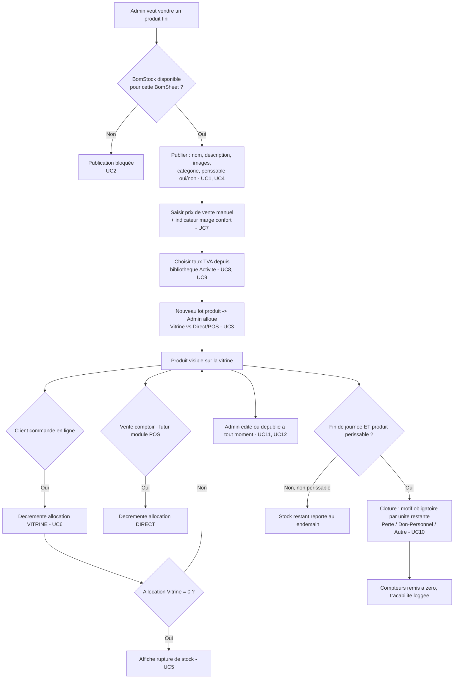

# Brainstorm Module — Boutique / Produits
> mentalyas · Full-Stack Dev
> Date : 2026-07-24
> Statut : Brainstorm module exporté — prêt pour implémentation
> Référence macro : `docs/FONDATION-HORECA.md`
> Étape 2 de la cascade de brainstorms (voir `CLAUDE.md` § Méthodologie de conception)

---

## 1. Rappel du besoin

Premier module choisi pour boucler le gap identifié dans le code : la vitrine cliente (`storefront/[tenantSlug]/catalog`, `checkout`) existe et fonctionne déjà, mais côté admin, `products/page.tsx` et `cms/page.tsx` sont des coquilles vides — impossible aujourd'hui de publier un produit vers cette vitrine. Principe directeur : **le stock est la vérité** — on ne publie que ce qui existe réellement en stock, et la boutique reflète ce stock en temps réel (rupture automatique).

---

## 2. Constat technique — état réel du schéma

Le modèle `Product` existant est **déconnecté du moteur BOM actuel** :

| Champ actuel (`Product`) | Problème |
|---|---|
| `recipeId String? @unique` → pointe vers `Recipe` | `Recipe`/`RecipeIngredient` est l'ancien MVP BOM (session 2026-07-16), remplacé depuis par `BomContext`/`BomLevel`/`BomSheet`/`BomLine`/`BomStock` (sessions 2026-07-23/24). Un produit publié doit venir d'une **`BomSheet`**, pas de `Recipe`. |
| `vatRate VatRate` (enum figé `FOOD_6` / `STANDARD_21`) | Enum Prisma en dur — incompatible avec la bibliothèque de taux configurable par Activité décidée dans ce brainstorm. |
| `stockType String @default("unlimited")` + `stockQuantity Int?` | Un seul entier global — incompatible avec l'allocation par canal (Vitrine vs Direct/POS) et le lien à un lot de production précis. |
| *(absent)* | Pas de flag périssable, pas de notion de clôture quotidienne. |

Point positif réutilisable : `BomStock` a déjà `qtyAvailable`, `unitCost`, `producedAt` et surtout **`dlcDate`** — la notion de lot périssable avec date limite existe déjà au niveau production, il faut juste la router jusqu'au produit publié. `Recipe.marginCoeff` (déjà en base, défaut `2.5`) confirme que l'indicateur de marge configurable est une idée déjà anticipée ailleurs dans le projet — à porter sur `Product` plutôt que réinventer.

---

## 3. Use Cases

| # | Acteur | Use case |
|---|--------|----------|
| UC1 | Admin | Publier un produit fini vers la Boutique à partir d'une fiche BOM (`BomSheet`) ayant du stock disponible (`BomStock.qtyAvailable > 0`) |
| UC2 | Admin | Refuser/bloquer la publication si aucun stock n'existe pour la fiche sélectionnée |
| UC3 | Admin | Allouer manuellement une quantité d'un lot de production entre canal **Vitrine** (en ligne) et canal **Direct/POS** (comptoir) |
| UC4 | Admin | Définir un produit comme **périssable** (active la clôture quotidienne obligatoire) |
| UC5 | Client (storefront) | Consulter le catalogue et voir automatiquement "rupture de stock" quand l'allocation Vitrine est épuisée |
| UC6 | Client (storefront) | Commander un produit → décrémente l'allocation **Vitrine** spécifiquement, jamais l'allocation Direct/POS |
| UC7 | Admin | Saisir un prix de vente manuel, avec un indicateur (non bloquant) de marge par rapport au coût de production et à un facteur cible configurable (x2, x3...) |
| UC8 | Admin | Configurer une bibliothèque de taux de TVA au niveau de l'Activité (ex. 21% / 12% / 6%) |
| UC9 | Admin | Assigner un taux de TVA à un produit depuis cette bibliothèque, potentiellement un taux différent par canal (POS "sur place" vs Boutique "à emporter") |
| UC10 | Admin/Responsable | Clôturer la journée pour les produits périssables : chaque unité restante (Vitrine + Direct) doit recevoir un motif (Perte/Jeté, Don/Personnel, Autre) et est tracée (qui, quand) |
| UC11 | Admin | Éditer un produit publié (prix, TVA, infos vitrine) à tout moment |
| UC12 | Admin | Dépublier un produit (`isVisible = false`) sans supprimer son historique |

---

## 4. Workflow utilisateur complet

---

## 5. Modèle de données — évolutions proposées

> Proposition d'architecte-consultant, à valider/ajuster au moment du code — pas gravé dans le marbre.

- **`Product`** : remplacer `recipeId → Recipe` par un lien vers `BomSheet` (ex. `bomSheetId`). Ajouter `isPerishable Boolean @default(false)`. Ajouter `marginTargetFactor Decimal?` (indicateur confort, cf. `Recipe.marginCoeff` déjà existant ailleurs). Retirer `stockType`/`stockQuantity` au profit de la table d'allocation ci-dessous. Remplacer l'enum `vatRate VatRate` par une relation vers `TenantVatRate`.
- **`TenantVatRate`** *(nouveau)* : `id`, `tenantId`, `label`, `ratePercent`, `isActive` — la bibliothèque configurable par Activité (remplace l'enum figé `FOOD_6`/`STANDARD_21`).
- **`ProductChannelStock`** *(nouveau)* : `id`, `productId`, `bomStockId` (lot source), `channel` (enum `VITRINE` / `DIRECT`), `qtyAllocated`, `qtyRemaining` — porte l'allocation manuelle par lot et par canal (UC3), et c'est cette table que décrémentent le checkout (UC6) et le futur POS.
- **`StockClosure`** *(nouveau)* : `id`, `tenantId`, `productChannelStockId`, `qtyLeft`, `reason` (enum `WASTE` / `STAFF` / `OTHER`), `note`, `closedByUserId`, `closedAt` — la clôture quotidienne tracée (UC10), pièce centrale du pilier anti-fraude.
- **`vatRate` par canal** (UC9) : si le besoin réel se confirme à l'implémentation, `ProductChannelStock` ou une petite table dédiée peut porter un `vatRateId` par canal plutôt qu'un taux unique sur `Product` — à trancher en codant selon ce qui reste le plus simple à maintenir.

---

## 6. Endpoints API nécessaires (`/api/v1/`)

| Endpoint | Usage |
|---|---|
| `POST /products` | Publier un produit depuis une `BomSheet` (UC1, UC2 — 400 si aucun `BomStock` dispo) |
| `PATCH /products/[id]` | Éditer prix, TVA, infos vitrine, dépublier (UC11, UC12) |
| `GET /products` (admin) | Liste avec allocations courantes |
| `POST /products/[id]/allocations` | Allouer un lot (`BomStock`) entre Vitrine/Direct (UC3) |
| `GET /tenant-vat-rates` / `POST /tenant-vat-rates` | Bibliothèque de taux TVA par Activité (UC8) |
| `POST /products/[id]/closure` | Clôture quotidienne d'une ligne périssable (UC10) |
| *(existant, à adapter)* `storefront/.../checkout` | Doit décrémenter `ProductChannelStock` canal `VITRINE`, pas `Product.stockQuantity` (UC6) |

---

## 7. Hors scope pour ce module (v2+/confort)

- Automatisation de l'allocation Vitrine/Direct (règle permanente) — le manuel reste la base
- Préremplissage automatique du prix de vente — jamais, seul l'indicateur de marge est affiché
- Taux de TVA par canal — implémenté seulement si le besoin réel se confirme (sinon un taux unique suffit au départ)
- Catégories/merchandising avancé de la vitrine (mis de côté, `category`/`sortOrder` déjà présents sur `Product` suffisent pour démarrer)

---

## 8. Prochaine étape

Implémentation guidée par ce workflow (étape 3 de la cascade) : coder dans l'ordre du diagramme §4, en testant chaque flux dans le navigateur au fur et à mesure (publication → allocation → vente vitrine → rupture → clôture), pas seulement en fin de développement.
