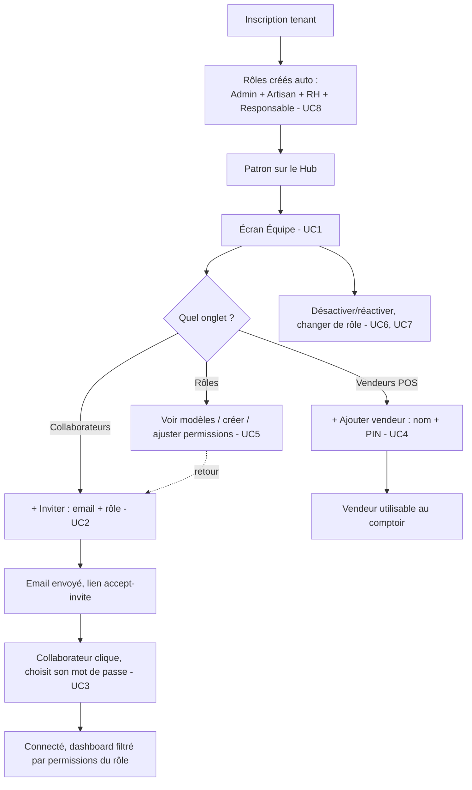

# Brainstorm Module — Équipe (Tenant/Users multi-rôles)
> mentalyas · Full-Stack Dev
> Date : 2026-07-28
> Statut : Brainstorm module exporté — prêt pour implémentation
> Référence macro : `docs/FONDATION-HORECA.md`
> Étape 2 de la cascade de brainstorms (voir `CLAUDE.md` § Méthodologie de conception)

---

## 1. Rappel du besoin

Clarifier et compléter la gestion des comptes du tenant. Aujourd'hui, à l'inscription, l'utilisateur devient automatiquement Super Admin (rôle `Admin`, toutes permissions). Besoin : un écran unique où ce patron peut ensuite créer et gérer **tous les types de personnes** de son équipe — collaborateurs avec accès dashboard (Artisan, RH, Responsable...) **et** Vendeurs POS (comptoir, PIN) — avec des niveaux d'autorisation différenciés par responsabilité.

---

## 2. Constat technique — état réel du code (audit direct, pas de suppositions)

| Élément | État constaté |
|---|---|
| `User` / `Role` / `UserInvitation` (schéma) | Complets. `Role.permissions` (Json) porte ~40 permissions granulaires déjà utilisées dans tout le code (`src/lib/constants/permissions.ts`). |
| `POST /api/v1/users` | **Existe et fonctionne** — invite par email (token 7 jours), envoie `sendEmployeeInviteEmail`. Permission `team.manage`. |
| `POST /api/v1/users/accept-invite/[token]` | **Existe** — crée le `User`, marque l'invitation utilisée, connecte automatiquement (session JWT). |
| `GET /api/v1/users`, `PATCH /api/v1/users/[id]` | **Existent** — liste + modification (rôle, activation) des collaborateurs. |
| `GET/POST /api/v1/roles`, `PATCH /api/v1/roles/[id]` | **Existent** — CRUD de rôles custom avec permissions à la carte, `OPTIONS /roles` liste toutes les permissions disponibles pour construire un formulaire de cases à cocher. |
| `Vendeur` / PIN comptoir | **Existe et fonctionne** — entité séparée de `User` (décision de cadrage POS.md), gérée aujourd'hui sur `/pos/vendeurs` (`GET/POST /api/v1/pos/vendeurs`, `PATCH .../[id]`), PIN unique par tenant depuis le fix du 2026-07-27. |
| Page frontend `/auth/accept-invite/[token]` | **N'existe pas.** Le lien envoyé par email (`sendEmployeeInviteEmail`, `src/lib/email.ts:217`) mène à un 404 — aucun collaborateur ne peut aujourd'hui accepter une invitation. |
| Page frontend `/settings/team` (nav "Équipe") | **N'existe pas** — lien mort dans `src/lib/constants/nav.ts:37`. |
| Rôles créés à l'inscription (`register/route.ts`) | Seulement `Admin` (`isSystem: true`, toutes permissions). Aucun modèle de rôle par défaut pour les autres profils. |
| Page `/pos/vendeurs` (nav "Vendeurs", `nav.ts:50`) | Existe et fonctionne, mais **séparée** de la gestion des collaborateurs — deux menus pour gérer des personnes, demande explicite de l'utilisateur de fusionner. |

**Conclusion : aucune évolution de schéma nécessaire.** Ce module est presque entièrement frontend (2 pages à créer) + une évolution ciblée du seed de rôles à l'inscription — le contraire de POS/Boutique-Produits qui demandaient un vrai travail de modélisation.

---

## 3. Décisions de cadrage validées (AskUserQuestion, 2026-07-27/28)

1. **"Vendeurs" = les `Vendeur` POS existants** (PIN comptoir), pas un nouveau rôle dashboard. Le patron veut un **menu unique** pour créer tous les types de personnes.
2. **Rôles dashboard pré-configurés** (Artisan, RH, Responsable) créés automatiquement, ajustables ensuite via les permissions à la carte déjà existantes — pas de "tout sur-mesure à chaque fois".
3. **Invitation par email uniquement** pour les collaborateurs dashboard — garde le flow existant (la personne choisit son propre mot de passe, jamais connu de l'admin). Pas de création directe avec mot de passe temporaire.
4. **Écran unique, onglets séparés** : "Collaborateurs" (dashboard) / "Vendeurs POS" (PIN) / "Rôles" — pas une liste mélangée. `/pos/vendeurs` est absorbé comme onglet (même principe que la consolidation Production de la session précédente : un seul chemin pour une même action).

---

## 4. Use Cases

| # | Acteur | Use case |
|---|--------|----------|
| UC1 | Super Admin | Consulter en un seul écran (onglets) les collaborateurs dashboard et les vendeurs POS |
| UC2 | Super Admin | Inviter un collaborateur par email en lui assignant un rôle (modèle prédéfini ou custom) |
| UC3 | Collaborateur invité | Accepter l'invitation via le lien reçu, choisir son mot de passe, accéder au dashboard avec les permissions de son rôle |
| UC4 | Super Admin | Créer un Vendeur POS (nom + PIN) — existant, déplacé dans l'onglet Vendeurs POS |
| UC5 | Super Admin | Gérer les rôles : voir les modèles prédéfinis (Artisan, RH, Responsable, Admin), créer un rôle custom, ajuster les permissions d'un rôle existant |
| UC6 | Super Admin | Désactiver/réactiver un collaborateur ou un vendeur POS (jamais de suppression physique — cohérent avec `isActive` partout ailleurs dans l'app) |
| UC7 | Super Admin | Changer le rôle d'un collaborateur existant |
| UC8 | Système | À l'inscription du tenant, créer automatiquement `Admin` (existant) + les modèles `Artisan`/`RH`/`Responsable` prêts à l'emploi |

---

## 5. Workflow utilisateur complet

---

## 6. Modèle de données — aucune migration, seulement des données par défaut

> Pas de nouvelle table. Proposition de permissions pour les 3 modèles de rôle (architecte-consultant, ajustable au moment du code) :

- **Artisan** : `ingredients.read/write`, `recipes.read/write`, `bom.read/write/produce`, `activites.read`, `stocks.read`, `achats.read/write` — production et stock, pas de Paramètres/Équipe/Facturation.
- **Responsable** : `pos.read`, `orders.read/manage`, `invoices.read`, `team.read`, `activites.read`, `stocks.read` — consultation/supervision (correspond exactement au persona "Responsable" déjà anticipé dans `docs/modules/POS.md` UC9/UC10/UC12, jamais implémenté faute de rôle existant).
- **RH** : `team.read` uniquement pour l'instant — le module RH n'existe pas encore (`FONDATION-HORECA.md`), ce rôle n'a de sens aujourd'hui que pour voir la liste de l'équipe ; permissions à étendre quand le module RH sera brainstormé.
- **Admin** *(existant, inchangé)* : `isSystem: true`, toutes permissions.

Ces 4 rôles sont créés dans la transaction de `POST /api/v1/auth/register` (à côté du `Admin` déjà créé) — **aucune migration de schéma**, une évolution du seed applicatif uniquement.

---

## 7. Endpoints API — déjà tous existants

| Endpoint | Usage | État |
|---|---|---|
| `POST /api/v1/users` | Inviter un collaborateur — UC2 | ✅ existe |
| `POST /api/v1/users/accept-invite/[token]` | Accepter l'invitation — UC3 | ✅ existe |
| `GET /api/v1/users`, `PATCH /api/v1/users/[id]` | Lister/gérer les collaborateurs — UC1, UC6, UC7 | ✅ existent |
| `GET/POST /api/v1/roles`, `PATCH /api/v1/roles/[id]`, `OPTIONS /api/v1/roles` | Gérer les rôles — UC5 | ✅ existent |
| `GET/POST /api/v1/pos/vendeurs`, `PATCH .../[id]` | Gérer les vendeurs POS — UC1, UC4, UC6 | ✅ existent (juste réutilisés dans le nouvel écran) |

Seul changement backend : `register/route.ts` crée 3 rôles de plus dans sa transaction existante.

---

## 8. Frontend à construire

- **`src/app/[locale]/(dashboard)/settings/team/page.tsx`** *(nouveau)* — 3 onglets (`Tabs` existant, `src/components/ui/Tabs.tsx`) :
  - **Collaborateurs** : `DataTable` sur `GET /api/v1/users`, bouton "+ Inviter" (email + select rôle), actions activer/désactiver/changer de rôle.
  - **Vendeurs POS** : reprend le contenu de `src/app/[locale]/(dashboard)/pos/vendeurs/page.tsx` (déjà écrit et testé) — déplacé, pas réécrit.
  - **Rôles** : `DataTable` sur `GET /api/v1/roles`, "+ Nouveau rôle" (nom + cases à cocher groupées par module via `OPTIONS /api/v1/roles`), édition d'un rôle existant. Les modèles Artisan/RH/Responsable apparaissent comme des rôles normaux (déjà créés), éditables comme n'importe quel rôle custom.
- **`src/app/[locale]/(auth)/accept-invite/[token]/page.tsx`** *(nouveau)* — mirroir de `(auth)/register` : prénom, nom, mot de passe → `POST /api/v1/users/accept-invite/[token]` → redirection dashboard connecté.
- **`src/lib/constants/nav.ts`** : retirer l'entrée `pos-vendeurs` (`nav.ts:50`), l'entrée `equipe` existante (`nav.ts:37`) pointe déjà vers `/settings/team` — juste à créer la page.

---

## 9. Hors scope pour ce module (v2+/confort)

- **Module RH complet** (contrats, planning, paie) — le rôle `RH` créé ici n'est qu'un point d'entrée permission, pas le module lui-même (voir `FONDATION-HORECA.md`).
- **Création directe avec mot de passe temporaire** (sans email) — décision de cadrage 2026-07-28, invitation email uniquement pour l'instant.
- **Rôles multiples par utilisateur** (`User.roleId` reste un seul rôle) — pas demandé, cohérent avec le modèle actuel.
- **Historique/audit des changements de rôle** — `AuditLog` existe déjà dans le schéma mais son usage pour ce module précis n'est pas dans le périmètre demandé ; à activer si besoin réel constaté.

---

## 10. Prochaine étape

Implémentation guidée par ce workflow (étape 3 de la cascade) : d'abord les rôles par défaut dans `register/route.ts` (rien d'autre n'a de sens sans ça), puis la page `accept-invite` (sans elle aucune invitation n'est utilisable), puis l'écran Équipe à 3 onglets en réutilisant `/pos/vendeurs` existant pour l'onglet Vendeurs POS, testé au navigateur à chaque étape.
