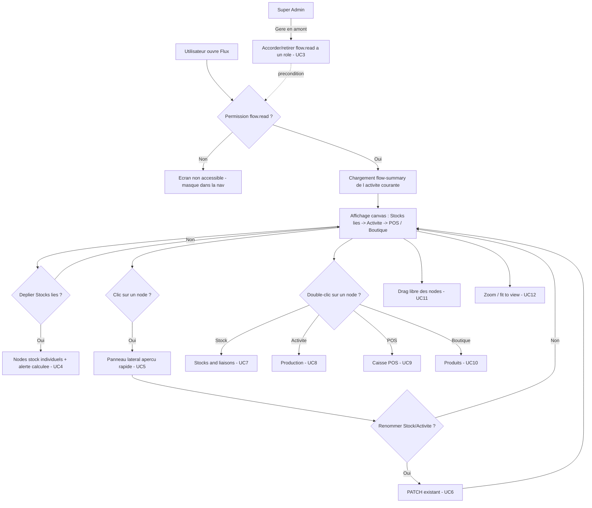

# Brainstorm Module — Vue Flux (Hub)
> mentalyas · Full-Stack Dev
> Date : 2026-07-26
> Statut : Brainstorm module exporté — prêt pour implémentation
> Référence macro : `docs/FONDATION-HORECA.md`
> Étape 2 de la cascade de brainstorms (voir `CLAUDE.md` § Méthodologie de conception)
> Origine : prototype visuel importé depuis un projet Claude Design (`flow-hub.jsx`, `app-data.js`, `components.jsx`, `tokens.css`) — mock React sans build, données fictives, à réécrire contre le vrai modèle de données.

---

## 1. Rappel du besoin

Le Super Admin veut une **vue globale visuelle** d'une activité, façon diagramme de flux d'usine (référence assumée : Satisfactory / Alchemy Factory) — comprendre en un coup d'œil comment la matière circule : stocks liés → activité (transformation) → canaux de vente (POS / Boutique en ligne). Le besoin réel n'est pas de dupliquer les écrans existants (Stocks & liaisons, Production, POS, Produits) mais d'offrir un point d'entrée synthétique qui renvoie vers eux.

Décisions de cadrage prises en amont de ce document (brainstorm 2026-07-26) :
- **Permission dédiée** `flow.read`, attribuable/révocable par rôle par le Super Admin via l'écran Équipe existant — pas de nouvel écran de gestion des droits.
- **Granularité simplifiée** : le vrai circuit BOM (Contexte → Niveaux → Fiches) n'est **pas** représenté node par node dans le graphe — l'Activité reste une "boîte noire" résumée (alertes, nb de fiches actives). Le détail reste accessible via double-clic vers Production.
- **Canaux de vente en lecture seule** : pas de nouveau champ "POS actif / Boutique actif par activité" — ces états sont **calculés** depuis les données réelles (produits publiés + stock canal restant), jamais un toggle qui changerait un comportement métier.
- **Emplacement** : écran dédié à part entière (nouvelle entrée de nav "Flux", groupe Workflow), pas un widget inséré dans le Hub existant — le canvas a besoin de toute la largeur pour le zoom/pan.
- **Vue globale toutes-activités** (grille de cartes du mock) : **hors scope v1**, confirmée nice-to-have v2.
- **Couche financière** (coût par node, valorisation stock, CA par node, pertes — la vraie inspiration Satisfactory/Alchemy Factory) : **hors scope v1**, c'est la direction v2+ la plus significative de ce module, à reprendre dans un brainstorm dédié une fois le socle matière posé.

---

## 2. Constat technique — état réel du schéma (audit direct du code, pas du mock)

| Élément du mock | Réalité dans le schéma ArtisaStock v2 |
|---|---|
| `stocksParActivite[id].conso` / `.prod` (deux groupes distincts par activité) | **N'existe pas.** `Activite` ↔ `Stock` est une simple relation N:N (`ActiviteStock`) — un stock est juste "utilisé par" une activité, aucune distinction consommation/production. Le graphe v1 aura donc **un seul groupe "Stocks liés"**, pas deux. |
| `stock.capacitePct` / `stock.seuilAlerte` (par stock) | **N'existe pas sur `Stock`.** Le seuil d'alerte (`alertThreshold`) et la quantité (`stock`) sont portés par `Ingredient`, pas par `Stock` (l'emplacement physique). L'état "alerte" d'un `Stock` doit être **calculé** : `Lot.stockId = X` → `Lot.ingredientId` → au moins un `Ingredient` avec `stock <= alertThreshold`. |
| `canauxDefaut[activiteId] = { pos, boutique }` + switch sur le node | **N'existe pas.** POS et Boutique sont des modules globaux au tenant. Un produit est rattaché à une activité indirectement : `Product.bomSheetId` → `BomSheet.levelId` → `BomLevel.contextId` → `BomContext.activiteId`. L'état "canal actif" pour une activité = requête dérivée (au moins un `Product` visible de cette activité avec `ProductChannelStock.qtyRemaining > 0` sur le canal `VITRINE` ou `DIRECT`), jamais un champ stocké. |
| `getVentesForActivite(id)` (mock) | Équivalent réel possible via la chaîne `Product → BomSheet → BomLevel → BomContext.activiteId`, filtrée par `ProductChannelStock` par canal — **à écrire** côté agrégation, aucune requête existante ne le fait aujourd'hui. |
| Édition inline (renommer stock, ajouter stock, seuil...) | Les endpoints `PATCH /api/v1/stocks/[id]` (renommer un stock) et `PATCH /api/v1/activites/[id]` (renommer/désactiver une activité) **existent déjà** et sont réutilisables tels quels depuis le panneau latéral. Le reste (ajout de stock, gestion des seuils par ingrédient, liaison stock↔activité) a déjà ses propres écrans (`Stocks & liaisons`) — pas dupliqué ici. |

Conséquence : ce module est **presque entièrement additif** côté backend — une nouvelle permission + un nouvel endpoint d'agrégation en lecture seule. Aucune migration de schéma pour les stocks/activités eux-mêmes.

---

## 3. Use Cases

| # | Acteur | Use case |
|---|--------|----------|
| UC1 | Super Admin | Consulter le flux visuel d'une activité : stocks liés → activité → canaux de vente |
| UC2 | Rôle autorisé (`flow.read`) | Idem UC1, si la permission lui a été accordée |
| UC3 | Super Admin | Accorder/retirer la permission `flow.read` à un rôle (écran Équipe existant) |
| UC4 | Utilisateur autorisé | Déplier le node "Stocks liés" pour voir chaque stock individuellement avec son état d'alerte calculé |
| UC5 | Utilisateur autorisé | Cliquer un node → panneau latéral d'aperçu rapide (infos clés, pas de nouvelle règle métier) |
| UC6 | Utilisateur autorisé | Depuis le panneau, renommer un Stock ou l'Activité (réutilise les `PATCH` existants) |
| UC7 | Utilisateur autorisé | Double-cliquer un node Stock → navigation vers "Stocks & liaisons" |
| UC8 | Utilisateur autorisé | Double-cliquer le node Activité → navigation vers "Production" (contexte courant de l'activité) |
| UC9 | Utilisateur autorisé | Double-cliquer le node POS → navigation vers l'écran Caisse |
| UC10 | Utilisateur autorisé | Double-cliquer le node Boutique → navigation vers Produits |
| UC11 | Utilisateur autorisé | Réorganiser librement les nodes par glisser-déposer (layout en mémoire, non persisté en v1) |
| UC12 | Utilisateur autorisé | Zoomer/dézoomer, ajuster la vue au canvas |

---

## 4. Workflow utilisateur complet

---

## 5. Modèle de données — évolutions proposées

> Proposition d'architecte-consultant, à valider/ajuster au moment du code.

- **Aucune migration de schéma pour les stocks/activités/produits** — tout se déduit des relations existantes (`ActiviteStock`, `Lot`, `Product → BomSheet → BomLevel → BomContext`, `ProductChannelStock`).
- **`Permission`** (`src/lib/constants/permissions.ts`) : ajout de `flow.read` — même mécanisme que `pos.*`/`tenant-vat-rates.*` précédemment. Backfill ciblé des rôles existants requis en v1 (règle #28/#29 du JOURNAL — jamais un reseed complet).
- **Pas de persistance du layout** en v1 : les positions de drag vivent en `useState` côté client, réinitialisées à chaque rechargement (cohérent avec le mock). Une persistance par utilisateur/tenant est une piste v2 (voir §7).

---

## 6. Endpoints API nécessaires (`/api/v1/`)

| Endpoint | Usage |
|---|---|
| `GET /activites/[id]/flow-summary` *(nouveau)* | Agrégation lecture seule pour une activité : stocks liés (avec alerte calculée par stock), résumé activité (nb fiches BOM actives, alertes ingrédients agrégées), état POS (nb produits actifs canal `DIRECT`, aperçu), état Boutique (idem canal `VITRINE`) — UC1, UC2, UC4 |
| `PATCH /stocks/[id]` *(existant, réutilisé)* | Renommer un stock depuis le panneau — UC6 |
| `PATCH /activites/[id]` *(existant, réutilisé)* | Renommer/désactiver l'activité depuis le panneau — UC6 |

---

## 7. Hors scope pour ce module (v2+/confort)

- **Vue globale toutes activités** (grille de cartes, statuts POS/Boutique par activité) — confirmée nice-to-have v2 (2026-07-26).
- **Couche financière** (coût de production par node, valorisation de stock, CA par node, pertes) — c'est la vraie inspiration Satisfactory/Alchemy Factory du patron, mais un chantier significatif (coûts BOM déjà calculés ailleurs à agréger différemment, valorisation stock à définir). Mérite son propre brainstorm une fois le socle matière posé et testé.
- **Vue détaillée fidèle au circuit BOM** (un node par Contexte/Niveau plutôt qu'une boîte noire Activité) — repoussé si le besoin se confirme après usage réel du v1 simplifié.
- **Switch actif/inactif réel par canal de vente** (nouveau champ `Activite.posEnabled`/`boutiqueEnabled` qui changerait un comportement métier) — reste un indicateur calculé en v1.
- **Persistance du layout de drag** par utilisateur/tenant.
- **Édition avancée depuis le node** (ajout de stock, changement de seuil d'alerte ingrédient directement dans le panneau) — reste sur les écrans dédiés existants (Stocks & liaisons, Fiches & Stock).

---

## 8. Prochaine étape

Implémentation guidée par ce workflow (étape 3 de la cascade) : permission `flow.read` d'abord (type + backfill ciblé des rôles existants), puis l'endpoint d'agrégation `flow-summary`, puis l'écran/composant canvas (nouvelle entrée de nav "Flux") — repartant du prototype `flow-hub.jsx` pour l'interaction (drag, zoom, panneau latéral, animation des liens) mais entièrement réécrit contre les vraies données et la vraie permission, testé au navigateur au fur et à mesure.
