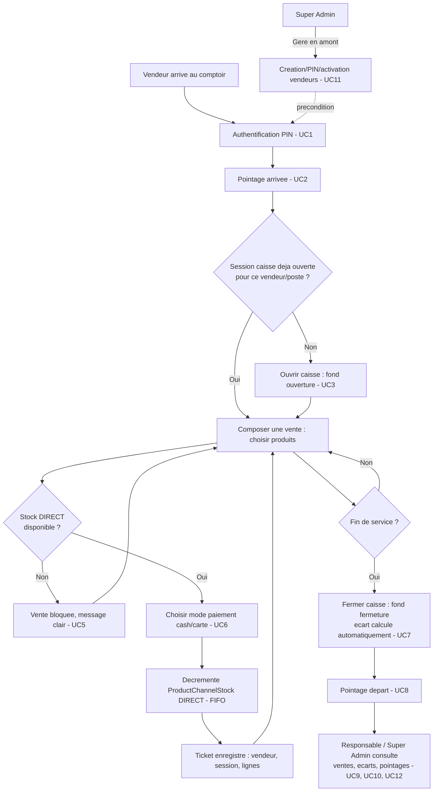

# Brainstorm Module — POS (Point de Vente)
> mentalyas · Full-Stack Dev
> Date : 2026-07-25
> Statut : Brainstorm module exporté — prêt pour implémentation
> Référence macro : `docs/FONDATION-HORECA.md` (absorbe `docs/FONDATION-POS.md`, 2026-07-23)
> Étape 2 de la cascade de brainstorms (voir `CLAUDE.md` § Méthodologie de conception)

---

## 0. Révision d'architecture — Vente à la demande (2026-07-26)

**Le §2 et les UC4/UC5/UC6 ci-dessous décrivent le design d'origine (canal `DIRECT` pré-alloué manuellement, décrémenté à la vente). Ce design est superseded** suite au scénario réel du patron (bar à cocktails) : les recettes du POS ne représentent **pas** des items déjà produits, mais des **fiches BOM** — la vente déclenche une **vraie production à l'instant T** (pas de stock comptoir pré-produit).

Ce qui change concrètement :
- `GET /pos/products` ne lit plus `ProductChannelStock` (canal `DIRECT`) : il calcule en direct, via `checkAvailability(bomSheetId, 1, prisma)`, le nombre maximum d'unités servables d'après le stock d'ingrédients réel (`directQtyRemaining` = plancher sur l'ingrédient limitant).
- `POST /pos/sales` ne décrémente plus `ProductChannelStock` : pour chaque ligne, il précalcule le coût (`calculateBomCost`, hors transaction), puis dans une seule transaction crée un vrai `BomProduction` (`notes: "Production automatique — vente comptoir POS"`), appelle `consumeFIFO` (même fonction anti-TOCTOU que "Lancer une production" en BOM — relit les lots au moment de la vente, rejette si le stock a changé depuis le précalcul), puis crée un `BomStock` avec `qtyAvailable: 0` (produit et vendu dans le même instant, jamais en inventaire).
- `PosSaleItem` gagne deux champs : `productionId` (FK vers le `BomProduction` déclenché, `onDelete: SetNull`) et `unitCost` (coût réel snapshoté au moment de la vente, indépendant du prix de vente) — permet au patron de voir marge réelle par vente (UC9/UC10 étendus), traçable jusqu'au détail de consommation par lot via `BomProductionLine`.
- Le canal `DIRECT` de `ProductChannelStock` est **retiré du panneau d'allocation produit** (`ProductAllocationPanel.tsx` ne propose plus que `VITRINE`) — le type reste toléré en lecture pour ne pas casser d'éventuelles lignes historiques, mais plus jamais créé.
- **Boutique Web (canal `VITRINE`) inchangée** : reste du stock pré-produit via `ProductChannelStock`, décrémenté par le webhook Stripe — seule la vente comptoir POS bascule en production à la demande.
- Conséquence UC5 : le rejet stock insuffisant reste un simple 400 (`INSUFFICIENT_STOCK`), jamais de statut `STOCK_CONFLICT` — cohérent avec le design d'origine, juste vérifié au niveau des ingrédients plutôt qu'au niveau d'un stock produit pré-alloué.

Raison du changement : dans un bar à cocktails, produire d'avance n'a de sens que pour la Boutique Web (livraison de cocktails embouteillés) — au comptoir, chaque commande est unique et doit consommer le stock d'ingrédients au moment exact de la vente, pas un stock intermédiaire qu'il faudrait sans arrêt réapprovisionner manuellement.

---

## 1. Rappel du besoin

Deuxième module de la cascade, après Boutique/Produits (terminé, 12/12 étapes). Le POS permet une vente comptoir (cash/carte déclaratif, pas d'intégration terminal réel) exécutée par un vendeur identifié, avec la même discipline de stock que la vitrine web : **aucune vente sans stock réellement disponible**, jamais de correction silencieuse. Décision de cadrage prise en amont de ce document (2026-07-25) : le POS **réutilise directement** l'infrastructure `Product`/`ProductChannelStock` construite pour Boutique/Produits — le canal `DIRECT` existe déjà dans le schéma depuis l'étape 1 de ce module, alloué mais jamais consommé faute de module vendeur. Le mode hors-ligne (PWA + sync tolérante) et l'authentification vendeur via `User`/RH sont explicitement **hors scope** de cette première passe (voir §7).

---

## 2. Constat technique — état réel du schéma (audit direct du code, pas du brainstorm FONDATION-POS.md d'origine)

| Élément | État constaté |
|---|---|
| `ProductChannelStock` (`channel: VITRINE \| DIRECT`) | **Existe déjà**, canal `DIRECT` alloué manuellement depuis l'étape 7 de Boutique/Produits (`ProductAllocationPanel.tsx`), mais **jamais décrémenté** — aucun code ne consomme le canal `DIRECT` aujourd'hui, contrairement à `VITRINE` (décrémenté par le webhook Stripe, étape 10). |
| `src/lib/products/channel-stock.ts` (`consumeChannelStockOrFlagConflict`) | Fonction FIFO déjà écrite pour `VITRINE`, **paramétrable par canal** (`channel: StockChannel = 'VITRINE'`) — directement réutilisable pour `DIRECT` sans dupliquer la logique de décrément. |
| `StockClosure` | Couvre déjà les deux canaux (`channel` lu depuis `ProductChannelStock` parent, pas depuis un champ propre) — la clôture périssable (étape 11) fonctionne déjà pour le stock `DIRECT` non vendu, sans changement. |
| `Vendeur`, `SessionCaisse`, `PointageHoraire`, `VenteSession`/`LigneVente` | **Aucune table n'existe** — à créer intégralement (repris de `FONDATION-POS.md` §3, non altéré depuis). |
| `User` (auth JWT admin) | Distinct de `Vendeur` par décision de cadrage — `User` porte l'auth email/mot de passe admin, `Vendeur` portera une auth PIN comptoir séparée, pas de couplage. |
| `Order`/`OrderItem` (storefront) | Modèle fortement couplé à la vente en ligne (`pickupSlot`, `stripeSessionId`, `trackingToken`, `customerId` obligatoire) — pas réutilisable tel quel pour un ticket comptoir sans client identifié ni créneau de retrait. Un modèle `VenteSession`/`LigneVente` dédié reste justifié, mais **uniquement comme métadonnées de ticket** (qui, quand, mode de paiement, montant) — la vérité du stock reste `ProductChannelStock`, jamais dupliquée. |
| `StockChannel` enum | `VITRINE` / `DIRECT` — aucun changement de schéma nécessaire, juste un troisième consommateur du canal existant. |

Conséquence directe : ce module n'a **pas besoin de bug de migration de schéma** comme Boutique/Produits en a eu (pas d'ancien modèle cassé à réparer) — c'est une extension propre d'une infrastructure déjà saine.

---

## 3. Use Cases

| # | Acteur | Use case |
|---|--------|----------|
| UC1 | Vendeur | S'authentifier rapidement au comptoir via PIN (pas le login JWT complet) |
| UC2 | Vendeur | Pointer son arrivée (horodatage lié à son ID) |
| UC3 | Vendeur | Ouvrir une session de caisse (déclarer un fond d'ouverture) avant de pouvoir vendre |
| UC4 | Vendeur | Composer une vente en sélectionnant des produits ayant du stock `DIRECT` disponible |
| UC5 | Système | Bloquer la vente si le stock `DIRECT` du produit est insuffisant — jamais de vente fantôme, jamais de correction silencieuse (contrairement au webhook Stripe, aucun paiement n'est encore capturé à ce stade : un simple rejet suffit, pas de statut `STOCK_CONFLICT`) |
| UC6 | Vendeur | Finaliser la vente en mode cash ou carte (label déclaratif uniquement) → décrémente `ProductChannelStock` canal `DIRECT`, FIFO, via `consumeChannelStockOrFlagConflict` déjà existant |
| UC7 | Vendeur | Fermer sa session de caisse en fin de service (déclarer un fond de fermeture) → le système calcule l'écart automatiquement (fond déclaré vs fond attendu = ouverture + ventes cash) |
| UC8 | Vendeur | Pointer son départ |
| UC9 | Responsable / Super Admin | Consulter l'historique des ventes POS (ticket par ticket : qui, quoi, quand, montant, mode de paiement) |
| UC10 | Responsable / Super Admin | Consulter les écarts de caisse par session et par vendeur |
| UC11 | Super Admin | Gérer les vendeurs (créer, définir/réinitialiser le PIN, activer/désactiver) |
| UC12 | Responsable / Super Admin | Consulter le pointage horaire de l'équipe (un Vendeur ne voit que ses propres pointages) |

---

## 4. Workflow utilisateur complet

---

## 5. Modèle de données — évolutions proposées

> Proposition d'architecte-consultant, à valider/ajuster au moment du code — pas gravé dans le marbre.

- **`Vendeur`** *(nouveau)* : `id`, `tenantId`, `firstName`, `lastName`, `pinHash`, `isActive`, `createdAt` — entité autonome, distincte de `User` (décision de cadrage). FK `Tenant`, jamais de lien direct vers un futur `Personnel` RH — une liaison API sera prévue quand le module RH existera (principe API-first déjà établi dans `FONDATION-HORECA.md`).
- **`SessionCaisse`** *(nouveau)* : `id`, `tenantId`, `vendeurId`, `openingFloat` (Decimal), `closingFloat` (Decimal, nullable tant qu'ouverte), `variance` (Decimal, calculé à la fermeture), `openedAt`, `closedAt` (nullable), `status` (`OPEN`/`CLOSED`).
- **`PointageHoraire`** *(nouveau)* : `id`, `tenantId`, `vendeurId`, `clockIn`, `clockOut` (nullable).
- **`PosSale`** *(nouveau, renommé depuis `VenteSession` de `FONDATION-POS.md` pour éviter la confusion avec `SessionCaisse`)* : `id`, `tenantId`, `vendeurId`, `sessionCaisseId`, `paymentMethod` (`CASH`/`CARD`), `totalTTC`, `createdAt` — **métadonnées de ticket uniquement**, aucun champ de stock (contrairement à `Order`, pas de `customerId` obligatoire ni de créneau de retrait).
- **`PosSaleItem`** *(nouveau, renommé depuis `LigneVente`)* : `id`, `posSaleId`, `productId`, `quantity`, `unitPriceTTC`, `totalTTC` — miroir de `OrderItem` mais sans TVA snapshot par ligne dans un premier temps (le prix `Product.priceTTC` suffit, pas de taux par canal — cf. Risques §4 du plan Boutique/Produits, décision différée).
- **Pas de nouvelle table de stock** : `PosSaleItem` ne fait que déclencher `consumeChannelStockOrFlagConflict(items, tx, 'DIRECT')` — même fonction que le webhook Stripe, paramètre `channel` différent.

---

## 6. Endpoints API nécessaires (`/api/v1/`)

| Endpoint | Usage |
|---|---|
| `POST /pos/auth` | Authentification vendeur par PIN → token de session comptoir court (distinct du JWT admin) — UC1 |
| `POST /pos/vendeurs/[id]/clock-in` / `clock-out` | Pointage horaire — UC2, UC8 |
| `POST /pos/caisse/open` / `POST /pos/caisse/[id]/close` | Ouverture/fermeture de session de caisse, calcul de l'écart — UC3, UC7 |
| `GET /pos/products` | Liste des produits vendables avec leur stock `DIRECT` restant (même agrégation que `bom/sheets` §avgUnitCost/availableStock, appliquée à `ProductChannelStock` canal `DIRECT`) |
| `POST /pos/sales` | Créer une vente : vérifie et décrémente `ProductChannelStock` `DIRECT` (via `consumeChannelStockOrFlagConflict`), refuse (400) si insuffisant — UC4, UC5, UC6 |
| `GET /pos/sales` | Historique des ventes (filtrable par vendeur/session/date) — UC9 |
| `GET /pos/caisse-sessions` | Liste des sessions de caisse avec écarts — UC10 |
| `GET /pos/vendeurs` / `POST /pos/vendeurs` / `PATCH /pos/vendeurs/[id]` | Gestion des vendeurs (admin) — UC11 |
| `GET /pos/pointages` | Historique des pointages (RBAC : Vendeur voit les siens, Responsable/Super Admin voient l'équipe) — UC12 |

---

## 7. Hors scope pour ce module (v2+/confort)

- **Mode hors-ligne** (PWA, file d'attente locale, sync tolérante) — décision de cadrage 2026-07-25 : reporté en v2 une fois le socle en ligne solide, conformément à la méthode "implémentation par petites étapes testées au navigateur" déjà suivie pour Boutique/Produits.
- **Intégration terminal de paiement réel** (Stripe Terminal, SumUp, Viva Wallet...) — label déclaratif cash/carte uniquement, comme prévu dans `FONDATION-POS.md` d'origine.
- **Impression physique de tickets de caisse.**
- **Configuration sectorielle par flags** (DLC, allergènes activables/désactivables) — reste une idée valide de `FONDATION-POS.md` mais non nécessaire pour faire fonctionner une première vente comptoir de bout en bout ; à réintroduire si un second secteur d'activité au-delà de l'HORECA se confirme.
- **Lien direct vers un futur module RH** (salaire, planning, shifts) — le Vendeur reste une entité POS autonome ; seule l'API est pensée pour permettre une liaison future, jamais un couplage en dur.
- **TVA par canal POS "sur place" vs Boutique "à emporter"** — un taux unique par produit suffit au démarrage (même décision différée que Boutique/Produits UC9).

---

## 8. Prochaine étape

Implémentation guidée par ce workflow (étape 3 de la cascade) : coder dans l'ordre du diagramme §4 — Vendeur + auth PIN d'abord (rien ne fonctionne sans identité), puis session de caisse, puis la vente elle-même (réutilisant `consumeChannelStockOrFlagConflict` pour le canal `DIRECT`), puis pointage horaire et écrans de consultation admin (ventes, écarts, pointages) en dernier — chaque flux testé dans le navigateur au fur et à mesure, pas seulement en fin de développement.
